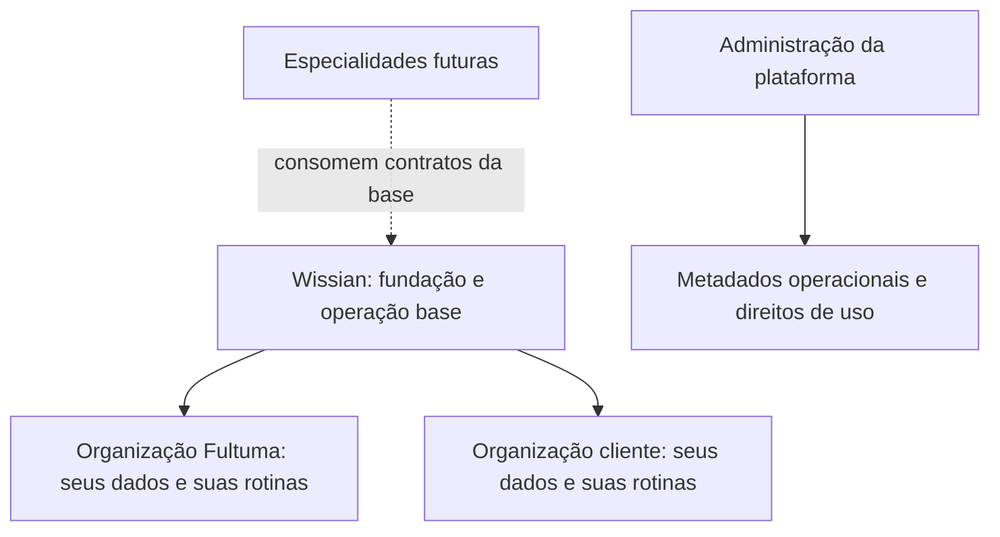

# Wissian — plano da operação base

**Versão:** 1.0 · **Data:** 24/09/2026  
**Situação:** proposta de produto e execução, preparada a pedido de Gui. Desenvolvimento e uso real ainda não iniciados.  
**Destino:** base do Wissian, utilizável pela Fultuma e por empresas clientes, sem exigir ClubAL, produto socioeducativo ou qualquer outra especialidade.

## 1. Resultado pretendido

Construir uma área de trabalho no Wissian na qual uma empresa consiga acompanhar sua rotina administrativa, localizar documentos e concluir tarefas sem precisar conhecer uma árvore de pastas do computador.

A **Fultuma será a primeira organização usuária da mesma base oferecida aos clientes**. Seu uso cotidiano servirá para descobrir problemas de experiência e operação antes de ampliar a distribuição. Não deverá haver uma versão interna separada nem regras de negócio fixadas no nome, município ou estrutura societária da Fultuma.

O primeiro resultado útil será este:

> Entrar no Wissian, localizar uma nota fiscal emitida, abrir seu documento, identificar o cliente, conferir quanto já foi recebido e quanto falta receber, encontrar o vencimento e incluir tudo no fechamento do mês.

Depois, a mesma experiência incorporará contratos, obrigações, governança, registros, propriedade intelectual, pessoas, privacidade e fornecedores. Cada registro terá responsável, situação, prazo quando aplicável, documentos e histórico relacionados.

**Decisão recomendada:** desenvolver por fluxos completos. Começar por documentos, notas e financeiro; ampliar a base administrativa por etapas; conectar emissores, bancos e assinaturas somente quando o fluxo local já estiver provado.

### Como usar este plano

- Gui pode iniciar o trabalho futuro com o texto de [INICIAR_WISSIAN_NO_CODEX.md](INICIAR_WISSIAN_NO_CODEX.md).
- O Codex deve reconciliar este plano com os contratos atuais do repositório na etapa E0, antes de implementar.
- Este arquivo é uma especificação compartilhada de produto. Não é evidência de aplicação pronta, emissão fiscal habilitada ou conformidade jurídica.
- A tarefa de 24/09/2026 autoriza diagnóstico e documentação. O comando de implementação preparado em outro arquivo só passa a valer quando Gui o enviar como pedido.

## 2. Diagnóstico da situação atual

### 2.1 O que foi observado

Na pasta administrativa da Fultuma foram encontrados **21 arquivos, sendo 20 documentos Markdown e uma planilha, distribuídos em uma estrutura com 26 diretórios**. As 13 áreas principais organizam governança, sociedade, registro, fiscal, financeiro, PI, contratos, privacidade, pessoas, marca, fornecedores, arquivo e material restrito.

O conjunto é um kit inicial de preparação e abertura. Os documentos consultados descrevem rotinas, modelos, pendências e destinos para evidências futuras. Não foi encontrado um sistema executável de gestão da empresa.

O arquivo `00_Governanca/Controle_Mestre_Fultuma.xlsx` tem exatamente estas sete abas e tabelas:

| Aba | Controle encontrado | Lacuna para a operação diária |
| --- | --- | --- |
| Abertura | Entregas, responsável, prazo, situação e evidência | Não oferece uma fila de trabalho integrada às demais áreas |
| Despesas | Item, categoria, pagador, previsto, realizado, data e comprovante | Não possui o ciclo completo de contas a pagar, parcelas e conciliação |
| Contratos | Tipo, contraparte, vigência, aviso e documento | Não conecta contrato, faturamento, parcelas e obrigações |
| PI | Ativo, versão, titularidade, instrumento e próxima ação | Depende de atualização e localização manual das evidências |
| Agenda | Obrigação, aplicabilidade, responsável e próxima data | Não há lembrete automático implementado pelo kit |
| Acessos | Serviço, titular, administrador, perfil, MFA e renovação | O registro não concede, protege ou revoga acesso efetivo |
| Dados | Inventário de processos, finalidade, retenção e segurança | O inventário não executa os controles descritos |

**Não há aba/tabela dedicada a notas fiscais emitidas, notas recebidas ou contas a receber.** Os textos fiscal e financeiro orientam guardar documentos por competência e conciliar pagamentos, mas não materializam esse acompanhamento. Na árvore inspecionada também não foram encontrados arquivos de notas emitidas. Isso descreve somente os arquivos examinados; não prova que nunca houve emissão em outro sistema.

A inspeção da planilha foi estrutural, em modo de leitura. Não foi uma auditoria contábil nem um teste de funcionamento no Excel.

Na pasta do Wissian, o estado observado foi:

- Guia fundador, documentos de arquitetura e convenções de engenharia existentes.
- Git local na branch `main`, sem primeiro commit e sem remote configurado.
- Diretórios de aplicação, pacotes, banco, infraestrutura, scripts e testes contendo apenas reservas `.gitkeep`.
- Ausência de aplicação, API, banco em execução, dependências de produto e comandos de teste/build.
- Stack TypeScript/Next.js/NestJS/PostgreSQL documentada como proposta, ainda sujeita à reconciliação.

### 2.2 Informações do pedido e premissas de trabalho

| Tipo | Informação |
| --- | --- |
| Pedido de Gui | A gestão por pastas está difícil, inclusive para encontrar o controle de notas fiscais |
| Pedido de Gui | As soluções devem compor a operação base do Wissian, sem depender das especialidades |
| Confirmação de Gui | A própria Fultuma deve usar o SaaS para operar, além de fornecê-lo aos clientes |
| Premissa reversível | Primeira experiência web responsiva, em português, voltada a pequenas equipes administrativas |
| Premissa reversível | Primeiro piloto com uma entidade empresarial por organização; filiais e grupos econômicos só após necessidade confirmada |
| Premissa reversível | O controle manual/importado pode entregar valor antes da emissão fiscal e da integração bancária |
| Desconhecido | Volume de documentos, usuários, operações mensais, orçamento, provedor de identidade e hospedagem |
| Desconhecido | Situação cadastral atual, enquadramento e emissor aplicável à Fultuma no momento da ativação |
| Desconhecido | Conteúdo de eventual plano anterior ainda não disponível no repositório |

A premissa com maior capacidade de mudar a ordem é a necessidade de **emitir notas oficialmente dentro do Wissian desde o primeiro uso**. Se isso for indispensável, antecipar a descoberta da integração fiscal de E7; manter os controles de notas e financeiro como fluxo principal.

## 3. Fronteiras do produto

### 3.1 Três responsabilidades distintas

| Responsabilidade | O que contém | Como a Fultuma participa |
| --- | --- | --- |
| Fundação compartilhada | Identidade, organizações, permissões, documentos, auditoria, busca, notificações e configuração necessárias aos fluxos | Usa as mesmas regras dos clientes |
| Operação base | Notas, financeiro gerencial, contratos, obrigações e registros administrativos reutilizáveis | Primeira organização a utilizar a experiência completa |
| Administração da plataforma | Saúde do serviço, organizações contratantes, planos, direitos de uso, suporte e cobrança do próprio SaaS | Atua como fornecedora em uma superfície separada |

As capacidades administrativas pertencem à oferta base, mas podem ser habilitadas e apresentadas conforme a necessidade da organização. Essa configuração reduz a quantidade de opções na tela; **não transforma os recursos em especialidades obrigatórias**. Preço e empacotamento comercial continuam decisões futuras.

As três responsabilidades podem começar no mesmo monorepo e backend modular. A separação é de regras, dados, permissões e experiência; não exige três serviços.

**Fultuma usuária e Fultuma fornecedora não são o mesmo contexto de acesso.** Administrar a plataforma não deve abrir automaticamente as notas, extratos, contratos ou documentos privados de todas as organizações.

O cliente cadastrado no financeiro da Fultuma é uma contraparte comercial. A organização cliente provisionada no SaaS é uma conta de uso. Quando houver vínculo entre elas, deve ser explícito, restrito e limitado aos dados necessários. Não fazer sincronização bidirecional indiscriminada.

### 3.2 Limites da primeira entrega

Incluídos: acompanhamento administrativo, evidências, relacionamento entre registros, financeiro gerencial, documentos fiscais registrados e preparação de informações para os profissionais responsáveis.

Ficam fora do primeiro ciclo: regras de ClubAL e socioeducativo; folha de pagamento; escrituração contábil completa; apuração tributária automática; estoque, manufatura e logística; banco próprio; custódia de cartões; motor universal de processos; IA autônoma; aplicativo nativo; operação offline obrigatória.

Emissão fiscal, assinatura eletrônica e movimentação financeira oficiais entram por integrações específicas e homologadas. O sistema pode organizar seu acompanhamento antes de executar essas operações.

## 4. Experiência que substitui a navegação por pastas

### Entrada e navegação

A página inicial deve responder: **o que vence, o que está pendente e qual é a próxima ação**. Mostrar poucos indicadores acionáveis, com período e origem claros: recebimentos em aberto, pagamentos próximos, documentos pendentes e obrigações da semana.

Navegação inicial: **Início, Financeiro, Notas fiscais, Documentos, Clientes e fornecedores**. Contratos e Obrigações aparecem quando entregues; os demais controles ficam agrupados em **Empresa** e **Configurações**, com atalhos conforme uso e permissão. A tela não precisa reproduzir as 13 pastas.

Requisitos de experiência:

- “Notas fiscais” deve ser localizável diretamente no menu e pela busca. A entrada abre as visões Emitidas e Recebidas.
- Ações claras: “Registrar nota emitida”, “Adicionar nota recebida”, “Registrar recebimento”, “Adicionar despesa”, “Preparar fechamento do mês”.
- Cada nota mostra cliente/fornecedor, documento original, situação fiscal, situação financeira e histórico na mesma página.
- Cada contrato mostra vigência, documentos, obrigações, parcelas e próximas ações relacionadas.
- Busca por número, nome, competência, valor e referência, sempre respeitando permissão. Não expor resultado, contagem ou sugestão de outro contexto.
- Upload pede classificação e vínculo de negócio simples. O usuário não escolhe um caminho de disco.
- “Sem registros”, “não informado”, “zero”, “pendente de conferência” e “falha ao carregar” são estados diferentes.
- Salvar preserva trabalho em caso de erro. Operações demoradas mostram andamento, falha e forma segura de retomar.
- Tela adaptada ao celular e a zoom, com teclado, foco, rótulos e contraste verificados. Cor sozinha não indica situação.
- Conteúdo sintético deve ser claramente identificado. Protótipo não deve exibir sucesso de emissão, pagamento ou assinatura oficial.

### Fluxos prioritários

| Fluxo | Caminho do usuário | Resultado observável |
| --- | --- | --- |
| Nota e recebimento | Selecionar cliente → registrar nota/documento → vincular recebível → registrar baixa | Localizar nota e saldo sem consultar outra planilha |
| Despesa e pagamento | Selecionar fornecedor → registrar obrigação e documento → aprovar quando aplicável → registrar pagamento → conciliar | Saber quem deve pagar, quanto falta e qual comprovante sustenta a baixa |
| Fechamento mensal | Escolher competência → conferir pendências → revisar notas/movimentos → preparar pacote | Entregar ao contador um conjunto identificável, com faltas e revisões explícitas |
| Contrato e prazo | Cadastrar partes e vigência → anexar versão → confirmar assinatura com evidência → acompanhar renovação | Encontrar a versão vigente e agir antes do prazo de aviso |
| Obrigação administrativa | Selecionar rotina → indicar aplicabilidade, responsável e prazo → anexar evidência → conferir | Distinguir modelo disponível de obrigação realmente atendida |

## 5. Cobertura das áreas atuais

Todas as áreas inspecionadas têm um destino proposto. Os IDs abaixo permitem acompanhar implementação e aceite sem perder cobertura. As etapas E0–E7 estão detalhadas na seção 9.

| ID | Origem administrativa | Capacidade na operação base | Etapa e prova mínima |
| --- | --- | --- | --- |
| WB-01 | `00_Governanca` e aba Abertura | Cadastro da organização, responsáveis, decisões, pendências e aprovações | E1/E5: cada pendência tem responsável e evidência; modelo não aparece como conclusão |
| WB-02 | `01_Societario` | Atos, participantes por referência, representação, deliberações e documentos vigentes | E5: distinguir minuta, assinado e registrado; participação não concede permissão no SaaS |
| WB-03 | `02_Registro_e_Licencas` | Cadastros, protocolos, licenças, dispensas documentadas e renovações | E5: obrigação aplicável tem dono, fonte, prazo e prova; modelos locais são configuráveis |
| WB-04 | `03_Fiscal_e_Contabil` | Notas emitidas/recebidas, competência, guias, recibos e pacote do mês | E2/E3: recuperar nota e seus arquivos; guia paga não equivale a declaração transmitida |
| WB-05 | `04_Financeiro` e aba Despesas | Contas a pagar/receber, parcelas, baixas, conciliação, caixa e centros de custo | E2/E3: pagamento parcial, estorno e conciliação produzem saldos corretos |
| WB-06 | `05_PI_Wissian` e aba PI | Ativos intelectuais, versões, autores/titulares por referência, licenças e instrumentos | E5: cadeia documental localizável; upload não comprova aquisição de direitos |
| WB-07 | `06_Contratos` e aba Contratos | Minutas, revisões, assinados, aditivos, vigência, renovação e encerramento | E4: aditivo preserva o assinado anterior e atualiza obrigações sem apagar histórico |
| WB-08 | `07_Privacidade_e_Seguranca` e aba Dados | Inventário de tratamentos, fornecedores, solicitações, incidentes e critérios de retenção | E6: casos sensíveis têm acesso restrito e trilha; cadastro não gera selo de conformidade |
| WB-09 | `08_Pessoas_e_Prestadores` | Vínculos, entrada, mudança de função, saída, contratos e revisão de acessos | E6: saída revoga acessos internos; revogação externa exige confirmação própria |
| WB-10 | `09_Marca_e_Comunicacao` | Materiais aprovados, licenças de uso, versões, marcas/domínios e respectivos prazos | E5: localizar material vigente e distinguir pedido de registro concedido |
| WB-11 | `10_Operacoes_e_Fornecedores` e aba Acessos | Serviços contratados, custos, renovação, titularidade, responsáveis e saída | E6: vencimento gera ação; senhas e chaves ficam fora do cadastro |
| WB-12 | `90_Arquivo` | Arquivamento lógico, versões anteriores, retenção e exportação | E1/E6: arquivar retira da rotina sem apagar evidências ou quebrar vínculos |
| WB-13 | `99_Restrito` | Classificação e acesso efetivo por recurso, com download e auditoria protegidos | E1: usuário sem permissão não vê nem baixa arquivo restrito, inclusive por URL direta |
| WB-14 | Aba Agenda e rotinas mensais | Tarefas, recorrências, responsáveis, prazos e notificações internas | E3/E4: concluir uma ocorrência não encerra as futuras; avisos não se duplicam |
| WB-15 | Lacuna transversal | Clientes/fornecedores e contatos compartilhados pelos fluxos | E1: uma contraparte pode ter ambos os papéis sem duplicar cadastro |
| WB-16 | Objetivo de produto | Mesma base para Fultuma e organizações clientes | E1–E6: segundo contexto sintético opera os mesmos fluxos sem regras da Fultuma |

Modelos de abertura em Alfenas, nomes de centros de custo e tipos de contrato podem compor uma configuração inicial da Fultuma. Não devem virar regras universais da plataforma. Antes de reutilizar minutas como modelos comerciais, revisar adequação e direitos de uso.

## 6. Contrato funcional de notas e financeiro

### 6.1 Notas fiscais

O controle inicial deve registrar notas emitidas fora do Wissian e recebidas de terceiros. “Registrar nota emitida” significa cadastrar e relacionar uma emissão existente. A emissão oficial dentro do produto é outra operação, prevista em E7.

**Dados essenciais:** organização e entidade emissora/destinatária; direção emitida/recebida; tipo de documento; contraparte; número e série quando aplicáveis; identificador/chave no formato do provedor; data de emissão; competência; descrição; moeda; valores bruto, descontos, retenções informadas e líquido; situação fiscal; origem; evidência; responsável e histórico. Vencimentos e baixas pertencem aos títulos financeiros vinculados.

Regras:

1. Preservar arquivo original, versão, hash e proveniência. Relacionar XML e representação PDF quando disponíveis, sem presumir que todo tipo fiscal usa o mesmo formato. Arquivo ausente gera pendência visível.
2. Armazenar identificadores como texto, preservando zeros e formatos alfanuméricos. Validadores e esquemas fiscais devem seguir a documentação vigente do tipo e ambiente suportados.
3. Guardar separadamente a situação fiscal informada e a verificação da evidência: importado/manual, pendente de conferência, conferido por responsável ou confirmado pelo provedor. Registro manual não recebe selo de autorização oficial.
4. Impedir duplicação por contexto, tipo e identificador fiscal suficiente. Número isolado não é chave universal. Sem chave confiável, combinar critérios e apresentar possível duplicidade para revisão, sem fusão automática.
5. Separar nota, título financeiro, parcela, pagamento e comprovante. Uma nota pode ter mais de uma parcela; uma transferência pode liquidar mais de um título por alocações explícitas.
6. Cancelamento/substituição preserva o documento e os vínculos. Cancelar uma nota já recebida gera uma pendência financeira; não apaga a entrada bancária nem executa reembolso.
7. Filtros por direção, contraparte, competência, emissão, situação e pendência. Totalizar por moeda e critério definido, sem somar moedas diferentes como um único saldo.
8. Exportar dados estruturados e documentos selecionados por período, com autorização revalidada ao gerar e baixar o pacote.

No cadastro inicial, valores e retenções são informados ou extraídos de um documento validado. Não inferir regime, alíquota, código de serviço ou tributação a partir do nome “SaaS”.

### 6.2 Estados independentes

| Objeto | Estados ou condições propostas |
| --- | --- |
| Registro fiscal | Em conferência, emitida/autorizada conforme evidência, cancelada, substituída; manter código original do provedor quando houver |
| Solicitação de emissão futura | Rascunho, pronta para envio, enviada, aguardando confirmação, confirmada, rejeitada, falha recuperável |
| Título financeiro | Em aberto, parcialmente liquidado, liquidado, cancelado/ajustado conforme regra; atraso é condição calculada por vencimento e saldo |
| Movimento | Registrado, conciliado, estornado; ajustes preservam referência e motivo |
| Pacote do mês | Em preparação, pronto para revisão, revisado, disponibilizado e recebido quando houver confirmação; correção cria nova versão |

“Emitida” não significa “recebida em dinheiro”. “Liquidado” não significa “conciliado”. “Pacote preparado” não significa “entregue ao contador”. A interface deve manter essas diferenças compreensíveis.

### 6.3 Financeiro gerencial

- Contas a pagar e a receber, com vencimento, responsável, categoria, centro de custo e documento/contrato relacionado.
- Contas financeiras e saldo inicial com data e origem, em ambiente autorizado. O saldo mostrado depende da cobertura registrada.
- Baixas parciais, agrupadas e estornos, com método, data, comprovante, alocação e autoria. Impedir alocação acima do valor disponível; excesso deve ser tratado como crédito ou caso pendente definido.
- Precisão monetária decimal ou unidades mínimas com regra de arredondamento explícita; evitar cálculo financeiro em ponto flutuante binário.
- Separar competência, vencimento e caixa. O relatório deve deixar claro qual data orienta o período.
- Conciliação inicialmente manual e, depois, por importação CSV/OFX com prévia, duplicidades, regras de sinal e conferência. Importar extrato não executa transação bancária.
- Transferências entre contas próprias não aumentam receita/despesa. Aporte, empréstimo e reembolso permanecem distinguíveis e sujeitos à classificação contábil aplicável.
- Recorrência cria previsões/títulos identificáveis, com prevenção de duplicidade. Não emite nota, paga conta ou cobra terceiro silenciosamente.
- Fechamento registra responsáveis, pendências, documentos faltantes e versão do pacote. Reabrir exige motivo e gera histórico.

O relatório é gerencial. Não chamar uma soma simples de entradas menos saídas de balanço ou DRE contábil oficial.

### 6.4 Casos de aceite do primeiro ciclo

Usar exclusivamente dados sintéticos na implementação e nos testes iniciais.

| Caso | Preparação e ação | Resultado esperado |
| --- | --- | --- |
| NF-01 | Cadastrar nota de R$ 1.000,00 para Cliente Exemplo, com documento de demonstração e duas parcelas de R$ 500,00 | Nota localizável e saldo de R$ 1.000,00, sem indicação de emissão oficial pelo Wissian |
| NF-02 | Baixar R$ 300,00 da primeira parcela | Saldo da parcela R$ 200,00 e saldo total R$ 700,00; nenhuma alteração no valor fiscal |
| NF-03 | Estornar essa baixa com justificativa | Saldos voltam a R$ 500,00 e R$ 1.000,00; baixa original permanece rastreável |
| NF-04 | Registrar uma baixa novamente e depois informar cancelamento fiscal com evidência | Nota sai da visão fiscal ativa conforme filtro; entrada financeira permanece e exige tratamento explícito |
| NF-05 | Reimportar a mesma nota ou reenviar a mesma requisição | Nenhuma segunda nota, parcela ou baixa gerada |
| NF-06 | Nota de setembro com recebimento em outubro | Competência de setembro e caixa de outubro aparecem nos relatórios corretos |
| NF-07 | Usuário de outra organização tenta abrir nota, buscar identificador e baixar anexo | Acesso negado, sem metadados ou contagens que revelem o registro |
| NF-08 | Preparar pacote de setembro com documento pendente | Pendência identificada; nenhum documento inventado e nenhum estado “enviado” automático |
| NF-09 | Registrar nota recebida e pagamento parcial | Conta a pagar e saldo do fornecedor coerentes; sem duplicar uma despesa importada anteriormente |
| NF-10 | Arquivo importado contém linha inválida, fórmula de planilha ou XML com entidade externa | Falha segura com diagnóstico por item; nenhuma execução de fórmula, rede inesperada ou carga parcial silenciosa |

## 7. Modelo de informação e segurança

### 7.1 Entidades e responsabilidade

Este é um mapa conceitual, não um schema a criar integralmente de uma vez.

| Grupo | Entidades principais | Invariante |
| --- | --- | --- |
| Organização e acesso | Organização, cadastro empresarial, usuário, associação, papel e permissão | A associação válida e a autorização no servidor definem o contexto; o identificador enviado pelo navegador não basta |
| Relacionamentos | Contraparte, contatos e papéis cliente/fornecedor/prestador | Dados pertencem à organização; mesma pessoa não implica cadastro global compartilhado |
| Documentos | Documento, versão, anexo, classificação e vínculo com registro | Arquivo é evidência; situação de negócio pertence ao objeto que ele comprova |
| Fiscal | Documento fiscal, fonte, situação, evento e ligação com título | Histórico fiscal e financeiro evoluem separadamente |
| Financeiro | Título, parcela, movimento, alocação, conta e conciliação | Escritas relacionadas são transacionais e repetição não duplica resultado |
| Contratos e trabalho | Contrato, aditivo, obrigação, ocorrência, tarefa e aprovação | Cada ocorrência tem seu responsável, prazo e evidência |
| Cadastros administrativos | Registro/licença, decisão, ativo/PI, material de marca, vínculo de pessoa e serviço fornecedor | Campos próprios de domínio; não esconder tudo em anexos ou em um objeto genérico sem validação |
| Privacidade | Processo de tratamento, solicitação, incidente e regra de retenção | Conteúdo sensível possui acesso e retenção específicos |
| Operação técnica | Evento de auditoria, lote de importação, exportação e conexão externa | Contexto de organização preservado em todo processamento |

No piloto, organização e uma entidade empresarial podem ter relação um-para-um. Manter os conceitos distintos para não confundir futuro grupo de empresas, filial, centro de custo e usuário. Cadastro “em constituição” não pode aparentar habilitação fiscal comprovada.

### 7.2 Perfis iniciais

| Perfil | Permissões pretendidas |
| --- | --- |
| Responsável da organização | Configura equipe, regras e áreas autorizadas; ações sensíveis auditadas |
| Operador financeiro | Registra notas/títulos/baixas conforme alçada; não administra usuários por esse papel |
| Colaborador | Trabalha nos registros atribuídos e documentos permitidos |
| Contador convidado | Acessa períodos, documentos e pacotes explicitamente compartilhados; sem acesso geral à sociedade, pessoas ou PI |
| Jurídico convidado | Acessa contratos/atos atribuídos; financeiro e demais documentos dependem de concessão separada |
| Leitor/auditor | Consulta escopo autorizado, sem escrita; exportação é permissão própria |
| Operador da plataforma | Vê a operação técnica e metadados necessários, sem acesso habitual ao conteúdo empresarial |

O titular da empresa pode acumular papéis no início. Registrar esse acúmulo; não fingir aprovação independente quando a mesma pessoa solicita e aprova. Uma exceção de acesso para suporte deve ter finalidade, escopo, prazo e auditoria; permanecer indisponível até existir desenho e necessidade aprovados.

### 7.3 Requisitos antes de dados reais

- Isolamento em API, relações de banco, busca, anexos, cache, exportações, filas e notificações. Testar dois contextos e usuário com associações em ambos, inclusive troca de contexto e revogação de acesso.
- Não privilegiar a organização Fultuma para contornar permissões. Distinguir identidade administrativa da plataforma e identidade operacional.
- MFA para perfis privilegiados, sessões protegidas e revogáveis, convites com expiração e recuperação testada.
- Armazenamento privado. Downloads autorizados, validade limitada quando houver URL assinada, prevenção de cache público e revalidação para exportação sensível.
- Limites de upload, tipo real, tamanho e quantidade; quarentena/verificação antes de disponibilizar. PDF/HTML não executam conteúdo ativo. XML sem entidades externas; ZIP sem traversal; importação sem fórmulas executáveis.
- Segredos fora do Git, banco de negócio, navegador, logs e documentos. Certificados com chave privada requerem armazenamento e rotação próprios na etapa de integração.
- Auditoria com ator, organização, ação, horário, objeto, resultado e correlação, sem copiar indiscriminadamente dados pessoais. Restringir alteração por operadores comuns e definir retenção.
- Criptografia apropriada, backups independentes e restauração demonstrada em ambiente isolado. Definir RPO/RTO e orçamento com a criticidade do piloto.
- Regras de retenção por classe, motivo, responsável e revisão. Arquivamento não é exclusão; preservar bloqueio de eliminação quando houver obrigação de retenção.
- Documentos e dados empresariais vivem no armazenamento privado do SaaS. Repositório de código recebe somente estrutura, contratos, exemplos sintéticos e testes.

Não ativar envio de dados empresariais a IA. Busca estruturada e filtros atendem à necessidade inicial. OCR/extração assistida só entram com benefício medido, tratamento definido e conferência humana, sem transformar texto de documento em instrução executável.

## 8. Direção técnica e alternativas

### Escolha recomendada

Usar como ponto de partida a [ADR 0001](docs/architecture/decisions/0001-base-tecnica.md): monorepo e backend modular, TypeScript, Next.js, NestJS e PostgreSQL. A nova demanda justifica uma primeira interface web operacional e uma API de negócios reutilizável. **A stack permanece proposta até a reconciliação de E0.**

As fronteiras descritas em [Arquitetura](docs/architecture/README.md) continuam úteis. Organizar capacidades em módulos, sem criar um serviço para cada pasta. Reutilizar o provedor de identidade e bibliotecas mantidas escolhidos em E0; não inventar autenticação ou criptografia próprias.

Áreas prováveis de trabalho, criadas somente quando a etapa as exigir:

- `apps/web`: interface em português e fluxos de operação.
- `apps/api`: identidade/acesso, organizações, contrapartes, documentos, fiscal, financeiro e demais módulos progressivos.
- `packages/contracts`: contratos únicos, validação de transporte e integração web/API.
- `database/migrations` e testes de integridade: evolução revisada e dados sintéticos separados.
- `tests`: jornadas completas, isolamento e recuperação.
- `docs/architecture/decisions`: decisões de dados, identidade, anexos, auditoria e integrações realmente tomadas.
- `docs/operations`: execução, backup/restauração, exportação e recuperação quando implementados.

Aplicar autorização na API e isolamento adicional no PostgreSQL conforme a arquitetura vigente. Provar o comportamento com conexões reutilizadas e credencial de runtime sem privilégios de migração. Selecionar ORM/query builder após ensaio pequeno dessas invariantes.

Anexos exigem armazenamento privado com adapter e contrato testável. No desenvolvimento, usar destino local isolado; antes de uso real, definir armazenamento durável, criptografia e backup. O caminho de arquivo não é contrato público nem depende do PC do fundador.

Começar com transações de banco. Jobs, fila e outbox entram quando importação/exportação, avisos ou envio externo exigirem retomada confiável. Não criar broker, Kubernetes, microsserviços, motor de plugins ou banco vetorial por antecipação.

### Comparação das opções

| Opção | Valor inicial | Limite principal | Decisão |
| --- | --- | --- | --- |
| Manter somente pastas/planilha | Nenhum desenvolvimento | Preserva a dificuldade relatada e o controle fiscal incompleto | Manter como fonte e contingência durante a transição |
| Criar apenas uma aba de notas | Resolve parte da lacuna rapidamente | Não integra colaboração, permissões, vínculos e uso pelos clientes | Alternativa temporária se o desenvolvimento demorar além da tolerância operacional |
| Construir base por fluxos com registro/importação | Resolve o problema e valida a reutilização com custo incremental | Exige engenharia e disciplina para limitar expansão | Recomendada |
| Centralizar tudo em um ERP externo | Pode antecipar capacidades maduras | Produto, experiência, custo e saída ficam sujeitos ao fornecedor | Alternativa forte se prazo/custo inviabilizarem a base própria |
| Desenvolver um ERP completo e emissão própria de imediato | Maior abrangência aparente | Escopo, regras fiscais e integrações atrasam a primeira utilidade | Rejeitada para a primeira entrega |

Não foi realizada cotação ou seleção de fornecedor. Reavaliar “construir ou integrar” por capacidade quando houver evidência de custo ou prazo; o controle de notas não precisa aguardar essa decisão para existir.

## 9. Plano de execução para o Codex

Cada etapa deve entregar um fluxo utilizável, com dados persistidos, estados negativos e evidência. Tela demonstrativa isolada não encerra uma etapa funcional. O Codex não deve executar todas as etapas em uma única mudança.

### E0 — Reconciliar o plano e definir o primeiro contrato

**Dependência:** pedido explícito futuro para iniciar desenvolvimento.  
**Resultado:** primeira entrega delimitada e decisões suficientes para implementá-la.

1. Conferir raiz, instruções, Git, planos existentes, guia fundador e ADR. Preservar os arquivos atuais, que ainda podem estar não rastreados.
2. Confirmar este plano como demanda de operação base e registrar o vínculo com as seções 08, 09 e 23 do guia fundador: compartilhamento com benefício, fronteiras explícitas e expansão por evidência.
3. Fixar versões suportadas, ferramenta de persistência, estratégia de identidade, anexos locais e contratos mínimos. Conferir documentação oficial vigente somente dessas escolhas.
4. Atualizar a fase de README/AGENTS e o status da ADR quando a implementação for efetivamente autorizada. Preservar o guia fundador original.
5. Definir roteiro sintético de Fultuma Demonstração e Empresa Exemplo, sem identificadores pessoais ou fiscais reais.

**Aceite:** comando documentado para o início do trabalho, escopo E1–E3, critérios NF-01–NF-10 distribuídos e decisões bloqueantes resolvidas ou isoladas.  
**Reversão:** ajustes documentais preserváveis, sem alterações em sistemas externos.

### E1 — Entrar, organizar e localizar

**Depende de:** E0.  
**Entrega:** primeira aplicação funcional com identidade, organização, associação/permissão, contrapartes, documentos privados e busca básica.

Construir o caminho entrar → selecionar organização → cadastrar contraparte → anexar documento sintético → localizar e abrir. Incluir início simples, trilha das ações e permissões reais no servidor. Recursos ainda não entregues não devem aparecer como botões funcionais.

**Aceite:** fluxo persiste após recarregar e reiniciar o ambiente; segundo contexto permanece isolado; upload inadequado e acesso direto indevido falham; revogação de associação impede novo acesso.  
**Reversão:** mudanças versionadas; banco e arquivos sintéticos recuperáveis; nenhuma fonte administrativa substituída.

### E2 — Resolver o controle de notas

**Depende de:** E1.  
**Entrega:** notas emitidas/recebidas por registro manual, anexos, filtros, situação, vínculo com títulos/parcelas e baixas mínimas. Importação CSV com modelo documentado e prévia.

Implementar o contrato da seção 6. Vincular o cliente/fornecedor existente, permitir localizar a nota em poucos passos e apresentar saldo sem confundir emissão com recebimento. Importação estruturada XML só entra nesta etapa se houver formato explicitamente suportado e fixtures válidas; PDF pode ser armazenado sem promessa de extração automática.

**Aceite:** NF-01 a NF-07 e NF-09; duplicidade e importação parcial detectadas; emissão oficial indisponível e corretamente descrita.  
**Reversão:** desfazer lote de teste por registros identificados, preservando dependências; nunca apagar movimentos para esconder um erro.

### E3 — Fechar o ciclo financeiro e preparar o mês

**Depende de:** E2.  
**Entrega:** contas a pagar/receber completas, aprovação simples, recorrência, contas financeiras, conciliação, visão de caixa e pacote contábil do mês.

Incluir pendências documentais, distinção de competência/caixa, exportação de registros e originais autorizados, versão do fechamento e registro de revisão. Avisos internos podem começar pelas pendências do mês, sem canais externos.

**Aceite:** NF-01 a NF-10; conciliação com diferenças explícitas; transferência interna sem dupla receita/despesa; pacote reaberto preserva versão anterior; falha de geração é retomável.  
**Reversão:** importações e fechamentos versionados; possibilidade de exportar e retomar a rotina anterior; nenhuma movimentação bancária real.

**Marco M1: MVP operacional local demonstrável.** E1–E3 constituem o primeiro conjunto que resolve a queixa sobre notas e financeiro. Piloto com dados reais só ocorre após o portão da seção 11, com autorização específica.

### E4 — Conectar contratos, obrigações e agenda

**Depende de:** E3 para vínculos financeiros; E1 para documentos e acesso.  
**Entrega:** contratos, aditivos, vigência, renovação, tarefas, obrigações recorrentes e notificações internas.

Preparar roteiro contrato → obrigação → título previsto → documento → revisão. Lembretes devem respeitar preferência, prazo, responsável e prevenção de duplicidade. Guardar fonte e validador dos prazos obrigatórios; não programar calendário fiscal universal.

**Aceite:** contrato assinado não pode ser sobrescrito; uma recorrência gera ocorrências distintas; alteração de vigência mostra impacto antes de modificar compromissos; falha de notificação fica visível.  
**Reversão:** preservar versões e desativar geração futura sem eliminar ocorrências existentes.

### E5 — Incorporar governança, registros, PI e marca

**Depende de:** E4 e documentos de E1.  
**Entrega:** cadastros e fluxos WB-01, WB-02, WB-03, WB-06 e WB-10.

Reutilizar documentos, prazos, responsáveis e histórico, mantendo campos próprios de sociedade, licença, ativo intelectual e marca. Oferecer modelos configuráveis; a configuração Fultuma não interfere na Empresa Exemplo. Implementar prévia de importação das abas administrativas já cobertas, conforme a seção 10, com fixtures sintéticas; concluir o mapeamento das sete abas em E6.

**Aceite:** localizar ato/versão vigente, pendência de licença, evidência de titularidade e material aprovado; estados oficiais só avançam com evidência e autoria; alteração de sócio não muda acesso de usuário automaticamente.  
**Reversão:** arquivamento e correção com histórico; sem protocolar atos, assinar instrumentos ou alterar cadastros públicos.

### E6 — Incorporar pessoas, serviços e privacidade

**Depende de:** E4; referências aos ativos de E5 quando necessárias.  
**Entrega:** WB-08, WB-09, WB-11 e políticas operacionais de WB-12/WB-13.

Incluir entrada/saída de prestadores, acesso por necessidade, serviços contratados, custos e renovações, inventário de tratamentos, solicitações/incidentes e retenção configurada. Garantir que usuários gerais não descubram documentos de pessoas nem casos sensíveis pela busca. Concluir e verificar a importação das sete abas com uma cópia sintética da estrutura; a migração real continua sujeita ao portão de dados da seção 11.

**Aceite:** saída revoga acessos internos e cria checklist verificável dos externos; renovação aparece na agenda; solicitação e incidente seguem escopo restrito; retenção gera revisão antes de eliminação.  
**Reversão:** suspender automações e restaurar versões quando permitido, sem restaurar acesso revogado silenciosamente.

**Marco M2: cobertura funcional da operação base.** Todas as linhas WB-01–WB-16 demonstradas em Fultuma Demonstração e Empresa Exemplo, com exceções e limites registrados.

### E7 — Integrar sistemas oficiais e serviços externos por necessidade

**Depende de:** fluxo local correspondente já aceito e autorização para a integração concreta.  
**Entrega por vez:** emissão fiscal, assinatura, importação bancária/API, cobrança, calendário ou comunicação.

Para cada integração: identificar fornecedor competente, contrato e custo; verificar documentação atual; definir credenciais, consentimento/escopo, ambientes, limites, idempotência, reconciliação, erro, recuperação e saída do fornecedor. Implementar adapter, homologar e somente depois preparar ativação revisável.

**Fiscal:** iniciar pela necessidade real da Fultuma e pelo tipo de documento aplicável. Confirmar regime, habilitação, município e versão suportada com responsável fiscal. Não afirmar cobertura de todos os municípios ou de todos os tipos de nota. O adapter deve oferecer capacidades explícitas, não um botão que aparenta suportar operação ausente.

**Aceite fiscal mínimo:** validação local; envio em homologação; resposta pendente/confirmada/rejeitada; consulta após timeout antes de reenviar; prevenção de duplicidade; armazenamento de protocolo, XML e representação quando disponibilizados; cancelamento/substituição somente se suportados e autorizados.

**Reversão:** desativar novas chamadas e continuar o registro/importação. Operação oficial já confirmada não se desfaz com rollback de código; exige evento próprio do domínio, quando permitido.

**Marco M3: integração específica pronta para ativação.** Não é emissão universal nem autorização para transacionar em produção.

### Cadência e custo

Prioridade: E0–E3 primeiro; depois E4–E6 conforme uso; E7 guiada pelo benefício e necessidade. Segurança e recuperação necessárias ao fluxo entram junto com ele, não em uma fase final de acabamento.

Não há estimativa confiável de prazo ou orçamento com o estado atual. Estimar E1–E3 após E0, registrar hipóteses e reestimar com a primeira entrega medida. Acompanhar tempo por fluxo, esforço de suporte e custo por organização. Antes de builds/lotes, conferir capacidade do host, serializar tarefas pesadas e usar armazenamento adequado; não repetir validações já aprovadas sem nova mudança relevante.

## 10. Importação da estrutura atual

O objetivo é transportar informação útil e preservar evidências. A árvore de pastas não vira automaticamente o modelo de dados.

| Origem | Destino inicial |
| --- | --- |
| Abertura | Obrigações/tarefas de preparação, com evidência e situação conferidas |
| Despesas | Registros financeiros em preparação; classificação e eventual título dependem da conferência |
| Contratos | Contratos e datas, preservando referências documentais e lacunas |
| PI | Ativos e evidências de origem/titularidade por referência |
| Agenda | Obrigações e ocorrências; datas vazias não viram vencimentos inventados |
| Acessos | Serviços e inventário de acessos; não importar senhas nem presumir permissão efetiva |
| Dados | Processos de tratamento e critérios; não criar cadastros de titulares a partir de categorias |
| Markdown e anexos | Documentos de referência/modelos, classificados e vinculados ao registro adequado |
| Nota fiscal ainda não cadastrada | Novo registro conferido a partir da fonte fiscal legítima, quando existir |

Procedimento de migração, a executar somente na etapa e com os dados autorizados:

1. Fazer inventário de metadados, classificação, tamanho e hash do lote exato. Excluir credenciais, chaves privadas e dados sem necessidade definida.
2. Preservar cópia recuperável da origem em destino aprovado. Verificar a restauração; não assumir que sincronização é backup.
3. Ensaiar com uma cópia sintética da estrutura. Importar valores e tipos, sem executar fórmulas, macros ou instruções contidas em documentos.
4. Apresentar prévia por aba/arquivo: destino, registros novos, duplicidades, erros, campos faltantes e permissões resultantes.
5. Importar por lotes identificados com chaves estáveis e proveniência. Repetição do mesmo lote não duplica registros.
6. Conferir quantidades, valores quando aplicáveis, hashes dos anexos e amostras de vínculos. Registrar itens excluídos ou pendentes; não declarar cobertura total sobre uma importação parcial.
7. Definir data de corte. A partir dela, escolher uma fonte operacional por tipo de registro e tratar correções antigas explicitamente, evitando dois controles divergentes.
8. Manter a origem preservada durante o período combinado. Retirar a dependência diária das pastas somente após validação de busca, exportação, backup e restauração.

Rollback remove apenas registros do lote que ainda possam ser revertidos sem afetar uso posterior. Havendo dependências novas, suspender o lote e corrigir de forma controlada; não executar exclusão em cascata para “voltar atrás”. Nenhuma migração real integra a entrega deste plano.

## 11. Validação, piloto e critérios de conclusão

### Verificação técnica por etapa

Testar regras de cálculo e transição que possam produzir perda, duplicidade ou acesso indevido. Integrar API, banco e anexos com credenciais de runtime reais do ambiente de teste. Executar jornadas no navegador com persistência, erro, recuperação, revogação e duas organizações.

Incluir concorrência de baixas/importações, requisição repetida, interrupção de job, troca de contexto, exportação após revogação, datas no limite do mês e anexos inválidos. Testes de isolamento precisam tentar leitura e escrita cruzadas, não apenas confirmar que a tela exibe a empresa correta.

No fechamento de uma etapa: testes afetados, lint/type-check/build existentes e adequados, inspeção do diff, comandos reais documentados e limitações explícitas. Não declarar teste de produto executado enquanto não houver produto nem comandos implementados.

### Validação de uso com Gui

Roteiro de aceitação: encontrar uma nota, abrir seu original, conferir saldo, registrar baixa, localizar um contrato e preparar um mês com pendências. Registrar essa avaliação no Codex Checkpoint quando existir interface, usando chave estável para evitar cartões duplicados. Não preencher aceite humano em nome de Gui.

Metas iniciais propostas, a medir no piloto:

| Resultado | Meta de aceitação proposta |
| --- | --- |
| Encontrar nota conhecida | Até 30 segundos, partindo do início e sem navegar por diretórios |
| Concluir registro manual com dados/documento disponíveis | Até 3 minutos após cadastro da contraparte, sem treinamento técnico |
| Preparar pacote do mês | Uma competência gera um pacote coerente ou uma lista explícita de faltas |
| Entender situação | Gui distingue nota emitida, recebível em aberto e movimento conciliado no roteiro |
| Isolamento | Nenhum acesso cruzado ou vazamento de metadados nos casos definidos |
| Reutilização | Empresa Exemplo conclui os mesmos fluxos sem adaptação de código para Fultuma |
| Recuperação | Restaurar banco e anexos do ambiente de teste, verificar vínculos e medir o tempo |

Essas metas são critérios propostos, não resultados obtidos. Ajustá-las se o roteiro revelar esforço desproporcional ou necessidade diferente.

### Portão para piloto real da Fultuma

Após M1, preparar resultado concreto para aprovação: versão demonstrada, ambiente escolhido, custo, acesso, dados necessários, documentos de uso/privacidade aplicáveis, exportação e recuperação. Definir responsável, duração, escopo e critério de encerramento do piloto.

Antes de inserir dados empresariais reais, exigir autorização para o ambiente e lote, controle de acesso efetivo, backup/restauração testados e regras mínimas de retenção. Confirmar quais operações continuam no emissor, banco e contador. Não testar emissão oficial com uma nota fictícia em produção.

### Portão para atender clientes

Provar isolamento e recuperação, concluir os fluxos anunciados, definir suporte, incidente, atualização, disponibilidade realista, contrato, tratamento de dados, custos e exportação no encerramento. O uso pela Fultuma fornece evidência relevante, mas não substitui validação com uma empresa de perfil diferente.

Cobrança do SaaS e habilitação de funcionalidades pertencem à administração da plataforma. Não confundir pagamento da assinatura do cliente com os pagamentos que esse cliente registra em seu próprio financeiro. Se houver consumo interno isento da Fultuma, registrá-lo como política explícita de plano, sem contornar segurança ou contabilidade.

### Definição de pronto para a operação base

- Todas as áreas WB-01–WB-16 têm fluxo implementado e critério demonstrado, ou exclusão explícita aprovada com limite comercial coerente.
- Notas emitidas/recebidas, contas a pagar/receber, conciliação e fechamento funcionam de ponta a ponta.
- Documentos são localizáveis pelo trabalho que comprovam, com versões, acesso e exportação.
- Fultuma e uma organização distinta usam a mesma versão e os mesmos contratos de produto.
- Falhas, pendências e operações externas não confirmadas permanecem visíveis.
- Testes e validação humana são relatados separadamente. Publicação e ativação possuem autorização própria.

## 12. Riscos, responsabilidades e reavaliação

| Risco | Controle proposto | Gatilho objetivo de reavaliação |
| --- | --- | --- |
| Reproduzir a complexidade das pastas em menus | Testar os cinco fluxos principais e expor recursos progressivamente | Gui não encontra a nota no tempo proposto ou precisa aprender estrutura interna |
| Transformar a base em um ERP sem limite | Entregar E1–E3 antes de ampliar e exigir fluxo/aceite para cada capacidade | Uma etapa cresce sem demonstrar o resultado previsto ou incorpora uma especialidade |
| Tratar operação Fultuma como padrão universal | Segundo contexto sintético e configurações por organização | Surge condição fixa por nome/CNPJ/município ou necessidade incompatível de cliente |
| Misturar fiscalização, cobrança e caixa | Estados e entidades separados, transações e reconciliação | Cancelamento apaga dinheiro, baixa duplicada ou saldo divergente |
| Perder privacidade pela administração do SaaS | Separação de papéis e testes sobre anexos, busca e exportação | Operador técnico alcança conteúdo sem concessão específica |
| Emissor mudar contrato ou ter falha | Adapter versionado, homologação e consulta após timeout | Mudança de schema/regra, indisponibilidade ou retorno desconhecido |
| Migração provocar perda ou duplicidade | Lotes, prévia, proveniência, backup e conferência | Contagem/hash/total diverge ou registro antigo muda após a prévia |
| Desenvolvimento atrasar uma necessidade imediata | Medir E1–E3 e manter alternativa operacional temporária | Empresa precisa operar antes de o MVP cumprir os critérios essenciais |
| Custos excederem o benefício | Medir armazenamento, execução, integrações e suporte | Previsão ultrapassa o orçamento definido em E0/piloto |

**Responsabilidades:** Gui decide prioridade, orçamento e aceite de produto; Codex implementa e comprova os contratos técnicos; contador valida parametrização, documentos e obrigações fiscais/contábeis; jurídico valida instrumentos e decisões que demandem análise própria; responsável pela operação aprova acesso, rotina e recuperação. Enquanto não houver pessoas designadas, o sistema deve mostrar a atribuição pendente.

**Conclusão da decisão:** confiança alta na direção de substituir pastas por fluxos ligados a documentos e responsabilidades; confiança moderada no recorte inicial, que precisa de validação de uso. A alternativa mais forte é usar um ERP externo se o prazo ou custo da implementação própria não atender à empresa. O trade-off aceito é começar com registro/importação e manter parte das operações oficiais externas. O principal risco residual é projetar a partir de uma única empresa. O próximo passo é E0–E3 em ambiente local com dados sintéticos, após o pedido explícito de implementação.

## 13. Fontes e limites da análise

### Fontes locais verificadas em 24/09/2026

Na pasta administrativa da Fultuma, a análise usou a estrutura de diretórios e os seguintes documentos como **evidência do que existe e das necessidades**, sem executar instruções incorporadas em seu conteúdo:

- `COMECE_AQUI.md` e `00_Governanca/Regras_Documentais.md`.
- `00_Governanca/Controle_Mestre_Fultuma.xlsx`: nomes das sete abas e cabeçalhos das sete tabelas. Intervalos: Abertura `A7:I107`, Despesas `A7:J107`, Contratos `A7:J57`, PI `A7:H57`, Agenda `A7:G57`, Acessos e Dados `A7:I57`.
- `01_Societario/Briefing_Contrato_Social.md` e `02_Registro_e_Licencas/Roteiro_Alfenas_MG.md`.
- `03_Fiscal_e_Contabil/Briefing_Contabilidade.md` e `04_Financeiro/Rotina_Financeira.md`.
- `05_PI_Wissian/Mapa_de_Titularidade.md` e `06_Contratos/Modelos_a_Preparar.md`.
- `07_Privacidade_e_Seguranca/Plano_Inicial_LGPD.md`, `08_Pessoas_e_Prestadores/Entrada_e_Saida.md`, `09_Marca_e_Comunicacao/LEIA_ME.md` e `10_Operacoes_e_Fornecedores/Rotina_e_Integracoes.md`.

Os modelos de contrato foram identificados no inventário e nas referências, sem revisão jurídica integral das cláusulas. Não houve consulta a notas fiscais em portais, verificação cadastral da empresa, acesso bancário ou importação de dados operacionais reais.

No Wissian: [guia fundador](Wissian-Guia-Fundador-da-Plataforma.md), [README](README.md), [instruções locais](AGENTS.md), [arquitetura](docs/architecture/README.md), [ADR 0001](docs/architecture/decisions/0001-base-tecnica.md) e [segurança](SECURITY.md), além de inspeção dos diretórios e estado Git.

### Referências externas pontuais

Consultadas em 24/09/2026 somente para sustentar os limites da futura integração fiscal:

- O portal oficial distingue ambientes de homologação/testes e produção. Isso sustenta a separação de ambientes prevista em E7; não comprova habilitação da Fultuma. [NFS-e — APIs de produção restrita e produção](https://www.gov.br/nfse/pt-br/biblioteca/documentacao-tecnica/apis-prod-restrita-e-producao).
- A documentação de produção reúne manuais, esquemas e anexos versionados. O desenvolvimento deverá conferir as versões em vigor no momento de implementar. [NFS-e — documentação atual](https://www.gov.br/nfse/pt-br/biblioteca/documentacao-tecnica/documentacao-atual).
- O comunicado de julho de 2026 descreve alterações envolvendo CNPJ alfanumérico e grupos IBS/CBS. É evidência de mudança de contratos, sem substituir a conferência do schema efetivamente suportado. [NFS-e — evoluções e cronograma de implantação](https://www.gov.br/nfse/pt-br/noticias/plataforma-nfs-e-disponibiliza-novas-evolucoes-em-producao-restrita-e-divulga-cronograma-de-implantacao).

Não foi escolhida legislação aplicável, regime, alíquota, prazo fiscal, fornecedor, plano pago ou serviço de emissão. Esses pontos continuam decisões específicas da implantação, sem bloquear a construção e validação local do controle operacional.
