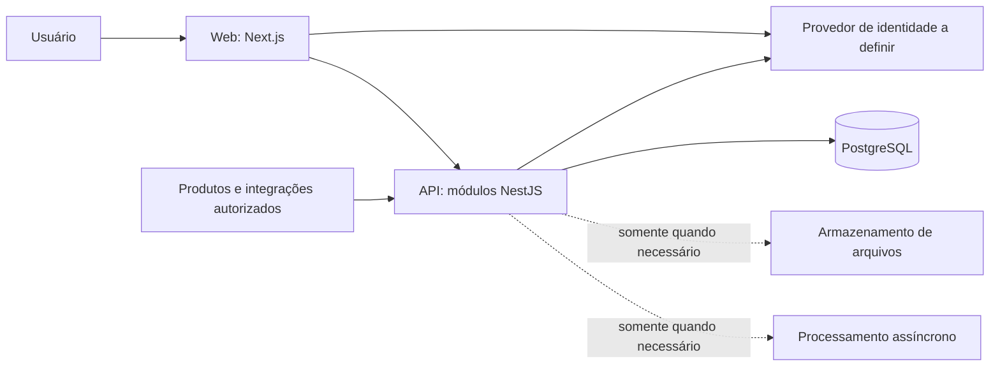

# Arquitetura proposta

**Status: proposta para confrontar com o plano de desenvolvimento.** Esta página descreve o destino do código; somente diretórios de primeiro nível foram reservados. Nenhum componente abaixo foi implementado.

## Requisitos que orientam a estrutura

| Referência no guia fundador | Consequência técnica proposta |
| --- | --- |
| 02, 06 e 08: plataforma para produtos distintos | API com contratos explícitos; domínio das verticais permanece nos produtos |
| 09 e 23: compartilhar somente o que é realmente comum | Módulos com responsabilidade e critérios para promoção ao núcleo |
| 10.5, 22 e 24: isolamento, permissões e confiança | Autorização no servidor, escopo de organização e testes negativos |
| 10.6 e 22: evolução e reversibilidade | Migrações versionadas, compatibilidade e recuperação planejada |
| 19 e 25: internacionalização e acessibilidade | Textos separados, fusos explícitos e testes de fluxos acessíveis |
| 34: evitar plataforma antes do negócio | Implementar capacidades por uso comprovado; não criar um serviço por item do guia |

## Forma do sistema

Recomenda-se **monorepo para código coordenado e monólito modular para o backend**. São decisões diferentes: o repositório pode conter web e API, mas a API começa como uma única aplicação, com fronteiras internas por capacidade. Cada processo poderá ser implantado separadamente quando existir.



O diagrama é conceitual. Provedor de identidade, arquivos e processamento assíncrono ainda não têm fornecedor ou implementação. A web não acessa o banco. Uma eventual camada de sessão/BFF no Next.js apenas adapta a comunicação; regras de negócio e autorização permanecem na API.

## Árvore de código a materializar durante o desenvolvimento

```text
apps/
  web/                              # interface de administração/uso definida pelo plano
    src/
      app/                          # rotas e layouts do Next.js
      features/<feature>/           # experiência de uma funcionalidade
      components/                   # componentes locais à aplicação
      lib/                          # integrações técnicas locais, sem domínio genérico
      messages/                     # catálogos de tradução
    public/                         # apenas arquivos públicos
    Dockerfile                      # quando houver build executável
  api/
    src/
      bootstrap/                    # configuração e composição da aplicação
      modules/<capability>/
        domain/                     # regras e invariantes do módulo
        application/                # casos de uso e interfaces necessárias
        adapters/                   # HTTP, persistência e serviços externos
        public.ts                   # API interna explicitamente exportada
    test/                           # integração HTTP + banco da API
    Dockerfile
packages/
  contracts/                        # contratos de transporte; nunca entidades do ORM
  sdk/                              # somente quando um consumidor justificar geração
  ui/                               # somente após reutilização real de componentes
  config/                           # somente para configurações de fato compartilhadas
database/
  migrations/                       # única sequência de migrações revisadas
  seeds/                            # dados sintéticos e identificados como tal
  tests/                            # integridade e isolamento de dados
infra/
  local/                            # configuração auxiliar do ambiente local
  iac/                              # após escolha de hospedagem e autorização
scripts/
  dev/                              # setup verificável, quando necessário
  check/                            # verificações da engenharia
  release/                          # empacotamento e operação com limites explícitos
tests/
  contracts/                        # compatibilidade entre produtores e consumidores
  e2e/                              # jornadas críticas completas
  security/                         # autorização e tentativas entre organizações
docs/
  architecture/decisions/            # ADRs
  engineering/                      # ambiente e contribuição
  api/                              # guias dos contratos quando existirem
  operations/                       # deploy, backup, restauração e resposta a falhas
```

Essa árvore não é uma lista de pastas a preencher imediatamente. Um módulo simples pode começar sem todas as camadas; separá-las quando houver regras e dependências que justifiquem isso. Testes unitários devem ficar junto do código que exercitam. `apps/worker/` só será acrescentado se uma tarefa assíncrona real exigir processo separado.

`apps/web/` não representa uma nova vertical obrigatória. O plano definirá a primeira interface necessária. Produtos verticais podem manter repositórios próprios e consumir contratos/SDK; se um produto compartilhar este monorepo, terá uma fronteira explicitamente aprovada. Nada será importado automaticamente de outro projeto da Fultuma.

## Responsabilidades e dependências

| Área | Responsabilidade | Limite |
| --- | --- | --- |
| Web | Apresentação, navegação, estado de interface e sessão | Sem SQL, credencial de banco ou autorização definitiva |
| API/módulos | Casos de uso, autorização e escrita dos dados de sua capacidade | Sem importação de detalhes privados de outro módulo |
| Contracts | Schemas de transporte e contratos versionados | Sem dependências de framework servidor, ORM ou segredos |
| Database | Migrações, integridade e políticas persistentes | Sem segundo histórico de migração dentro de apps |
| Infra | Configuração de execução e recursos | Sem regra de negócio, segredo versionado ou estado local no Git |
| Scripts | Automação de engenharia | Sem operações destrutivas implícitas ou resultado de sucesso fictício |

O domínio não depende de HTTP, ORM ou UI. Adapters implementam as interfaces necessárias aos casos de uso. A composição conecta as partes. Acesso entre módulos ocorre por exports públicos ou eventos explícitos; não por consultas escondidas a tabelas alheias. Transações que envolvam várias capacidades precisam de coordenação e responsabilidade definidas.

Identidade, organizações, acesso e auditoria são **candidatos** a módulos, condicionados ao primeiro fluxo do plano. Agenda, dispositivos, comunicação, cobrança e IA não entram por antecipação. Toda capacidade terá um responsável definido na tarefa/PR; enquanto a equipe não estiver formada, Gui decide prioridade e aceite de produto.

Promover uma capacidade ao compartilhado exige conceitos e regras compatíveis, consumidor identificado, contrato, responsável e benefício líquido. Dois nomes parecidos não bastam. Evitar um pacote `core` que centralize todas as regras.

## Dados e isolamento entre organizações

Premissa inicial: PostgreSQL compartilhado, com identificação explícita da organização nos dados que a ela pertencem. A relação entre organização, unidade e espaço de trabalho será definida pelo primeiro domínio; não tratar esses conceitos como sinônimos. Dados globais precisam ser declarados como globais.

A API valida identidade, associação e permissão antes de operar. Chaves, índices e relacionamentos devem impedir vínculos indevidos entre organizações. O contexto de organização precisa chegar também a jobs, cache, busca, arquivos e exportações; um filtro na tela não resolve isolamento.

RLS é recomendada como defesa adicional no PostgreSQL. A conexão de runtime não deve ser superuser, dona das tabelas ou possuir `BYPASSRLS`; migrações usam outra credencial. Avaliar `FORCE ROW LEVEL SECURITY` quando aplicável. Contexto de organização deve ser transacional e não sobreviver ao reúso da conexão. Testar leitura e escrita cruzadas, contexto ausente e pool reutilizado; RLS não substitui autorização de negócio. Essas restrições derivam do comportamento documentado de [Row Security Policies](https://www.postgresql.org/docs/current/ddl-rowsecurity.html).

Um único fluxo controlado aplica migrações de `database/migrations/`; não executar DDL automaticamente na inicialização de cada réplica. Usar mudanças compatíveis em etapas: adicionar, migrar, trocar consumidores e só depois remover. Rollback de aplicação não desfaz necessariamente dados; planejar restauração ou correção adiante e comprovar recuperação antes de mudanças destrutivas.

ORM/query builder fica em aberto até um ensaio pequeno de transações, migrações e RLS com pool real. As migrações aprovadas serão a autoridade de evolução do banco, inclusive SQL específico. Exigência de residência, isolamento dedicado ou restauração por cliente pode mudar o modelo; registrar nova ADR antes de usar dados desse contexto.

## Contratos, experiência e escala

- API REST com OpenAPI; fonte única para cada contrato e geração de clientes quando houver consumo real. Não manter DTOs equivalentes manualmente em web e API. Identificar mudanças incompatíveis e consumidores afetados.
- Catálogos de texto separados. Instantes em UTC quando representarem um instante; agendas e datas civis preservam o fuso IANA e a semântica local. Não converter todo conceito de data indiscriminadamente.
- Sessões, cache de páginas e carregamento no servidor devem preservar escopo de usuário/organização. Não usar cache compartilhado para resposta privada sem chave e política verificadas.
- Logs estruturados e correlação sem payloads sensíveis. Auditoria de ações não é o mesmo armazenamento nem a mesma retenção dos logs de diagnóstico.
- Primeira evolução de escala: medir consultas, paginação, índices, pool, filas necessárias e réplicas da API sem estado local. Anexos não devem depender do disco efêmero de uma réplica.
- Se um caso exigir banco + envio externo confiável, avaliar outbox, idempotência, retry limitado e tratamento de falhas. Não introduzir broker ou promessa de entrega única sem necessidade e prova.

Não há requisito que justifique agora Kubernetes, microsserviços por capacidade, múltiplas regiões, event sourcing, motor genérico de plugins, banco vetorial ou provedor de IA. Esses itens dependem de restrição ou gargalo demonstrado.

## Operação e verificações futuras

Desenvolvimento, homologação e produção terão credenciais e dados separados. A hospedagem fica em aberto. Recomenda-se avaliar PostgreSQL gerenciado e runtime de contêineres conforme região, custo, backup e saída do fornecedor. Compose serve ao ambiente local, não é uma topologia de produção aprovada.

Antes do primeiro uso real, demonstrar um fluxo ponta a ponta com autorização, duas organizações sintéticas, erro/recuperação, migração, backup/restauração e experiência acessível. Definir metas de disponibilidade, latência, RPO/RTO e orçamento a partir desse fluxo; não inventar números antes de conhecer sua criticidade.

A [ADR 0001](decisions/0001-base-tecnica.md) concentra alternativas, trade-offs e condições que mudariam esta proposta.
