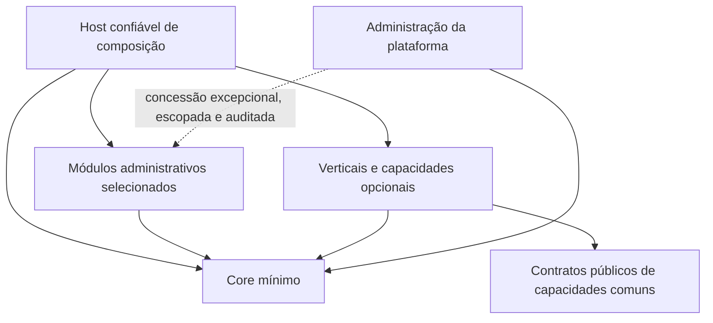

# Arquitetura alvo e contrato de modularidade

**Natureza:** especificação proposta para implementação futura. Deriva do pedido atual, Guia §§08/09/22/23, plano base §§3/7/8 e contratos v1.1 §§04/06. Não descreve runtime já construído.

## Limites e consumidores

### Product ownership and builder independence — Gui, 2026-10-08

Wissian is an independently owned SaaS. Lovable, Base44 and similar builders are temporary development accelerators, not required production operators. Their expertise may accelerate international delivery; ending a builder subscription must not be a required dependency for operating the target production architecture. This is a target requirement, not a claim that the current application is already independent.

Keep source, migrations, deployment configuration and recovery procedures versioned in owner-controlled repositories. Production accounts, domains, credentials and billing must remain under the owner's control. Reuse third-party and open-source software with its applicable licenses; product ownership does not imply ownership of those dependencies.

Independently contracted Supabase, Hostinger and Cloudflare are preferred candidates, not mandatory vendors or purchase authorization. Evaluate managed Supabase versus self-hosting, hosting capacity, recurring and renewal costs, maintenance burden and an exit path before committing. Builder independence does not require eliminating every managed service or moving all components onto one small VPS.

Prepare portability during development. Before moving customer traffic or cancelling the existing service, independently verify deployment outside the builder, authentication/provider configuration, tenant isolation, audited commands, document integrity and inspection, backup/export and isolated restoration, and rollback. Preserve users and data; keep the working environment until the replacement passes acceptance. This decision authorizes migration planning and reversible preparation, not immediate cutover, purchases, destructive changes or a claim that product roadmap gates are complete.

O diagrama representa dependências/contratos, não serviços a criar. O Core não importa módulos administrativos, verticais nem o host. Compartilhar repositório ou processo não mistura propriedade dos dados. A administração da plataforma possui seus casos de uso; não é um papel universal sobre a operação dos tenants.

| Camada | Responsabilidade | Regra de entrada |
|---|---|---|
| Core | Identidade, associação organizacional, autorização, configuração mínima, contrato de auditoria, registro/composição de módulos, fundações de entitlements | Necessário ao primeiro fluxo transversal, sem regra de setor |
| Shell | Navegação base, seleção autorizada de contexto, preferências e componentes de apresentação | Consome contratos; não decide segurança nem importa todas as verticais por um barrel |
| Capacidades comuns | Arquivos privados, notificações internas, agenda, busca, relatórios, integrações, releases, dispositivos | Opcionais; promover compartilhamento após equivalência semântica e consumidor comprovados |
| Operação administrativa | Contrapartes, documentos, notas registradas, financeiro; depois contratos, obrigações, governança, PI, pessoas, fornecedores, privacidade | Mesmo mecanismo de seleção de módulos; preço/oferta não define dependência de Core |
| Verticais | Socioeducativo, educação, ClubAL/Telas, eventos/clubes | Regras, vocabulário, dados e permissões próprios; podem consumir capacidades comuns |
| Adapters legados | Compatibilidade limitada com IDs, formatos e consumidores antigos | Prazo/owner e pares compatíveis explícitos; não importar todo o domínio original |

Frota, estoque/produtos/QR, RH, ponto/jornada, jurídico, fiscal, faturamento e apoio contábil integram o catálogo de direção do pedido. Não há alegação de implementação no legado nem prioridade automática antes de E0–E3. Emissão oficial, folha, tributação e contabilidade formal exigem contratos próprios; registro administrativo não simula sua execução.

## Identidade técnica própria — regra permanente de 25/09/2026

Por decisão expressa de Gui, o código do Core usa a identidade **Wissian**. A extração
remove nomes e dependências de produto legado dos namespaces, assemblies, tipos e
contratos públicos, identificadores de módulo/permissão, configurações, variáveis,
cookies, emissores/audiências, chaves de armazenamento e mensagens operacionais.
ClubAL, Base44, TEM, OWM, GRA, PEMSE e nomes de seus executores não entram no Core.
Não basta substituir palavras: remover regras, dependências e autoridade específicas
da origem, conservando o comportamento transversal que foi comprovado.

As fontes históricas e os hashes de procedência conservam seus nomes originais em
`docs/fontes/`, fichas/evidências e ensaios isolados de caracterização. Essas áreas
não integram o grafo ou artefato do Core. Código de origem não é renomeado nem editado.
Uma vertical opcional pode conservar uma identidade de produto deliberada, como
`clubal-telas` no catálogo proposto, sem importá-la no Core ou no shell neutro.

Cada absorção exige mapa explícito de nome antigo → nome próprio e teste de contrato.
M1 deve incluir verificação executável de nomes/identificadores e dependências do
Core, direta e transitiva, além do build neutro. Compatibilidade inevitável fica em
adapter opcional fora do Core, com consumidor, prazo e teste; nunca compartilhar
cookies, credenciais ou dados entre produtos. Nenhuma exceção é criada por conveniência.

## Módulos e addons opcionais para clientes

Módulo é uma capacidade de negócio selecionável; addon é a extensão opcional que
acrescenta capacidade ou especialidade à composição do cliente. Ambos obedecem ao
mesmo contrato técnico. Ser opcional não significa não ter dependências, nem define
automaticamente preço, plano ou cobrança separada. O Core é a fundação comum, não um
ERP obrigatório. As opções abaixo estão **planejadas, ainda não disponíveis**.

| Oferta/capacidade planejada | Módulos do catálogo | Prioridade e fronteira |
|---|---|---|
| Primeira base administrativa | `documents`, `counterparties`, `fiscal-records`, `finance`, `monthly-close` | M2–M4; composição `admin-first-cycle` do capítulo 17; regras permanecem fora do Core |
| Contratos e organização do trabalho | `contracts`, `agenda` | M5a por demanda; agenda não é dependência obrigatória de contratos |
| Governança, ativos intelectuais e pessoas | `governance`, `intellectual-assets`, `people-services`, `privacy` | M5b/c por fluxo; não condicionam o primeiro piloto |
| Especialidades de negócio | `socioeducativo`, `educacao`, `clubal-telas`, `eventos` | M6 por público e demanda; composições neutras não carregam vocabulário ou código dessas especialidades |
| Expansões administrativas | `fleet`, `inventory-qr`, `legal`, `hr-time`, `fiscal-issuance` | M8; emissão oficial e operações reguladas exigem contratos e autorização próprios |
| Capacidades transversais | `devices`, `displays`, `release-support`, `continuity` | Integração conforme consumidor; `continuity` é infraestrutura interna opcional após M4, sem produto/cobrança própria presumida |

O [catálogo proposto](contratos/catalogo_modulos.proposta.json) é a fonte dos IDs e
dependências. Exemplos: financeiro depende de contrapartes e pode funcionar sem notas;
notas registradas dependem de documentos e contrapartes; fechamento mensal consome
documentos, notas e financeiro. Recursos desligados não deixam menus vazios e suas
URLs/jobs continuam protegidos no servidor. Ausência física de uma vertical na
composição neutra e desativação por tenant são provas diferentes, ambas obrigatórias.

## Contrato de módulo (registro técnico)

Cada módulo declara ID estável, versão de contrato, owner, dependências obrigatórias, integrações opcionais, capacidades, permissões, rotas/UI, jobs/subscrições, propriedade de dados e migrações, classificação/retenção e estratégia de desativação. Os [exemplos](contratos/README.md) concretizam o modelo sem escolher framework ou criar loader dinâmico.

O catálogo é definido por código/configuração confiável, revisado e empacotado. Não carregar código arbitrário de cliente, DLL/JavaScript remoto, plugins de terceiros ou marketplace nesta fase. Novos módulos entram por uma release do produto; seleção de módulos já disponíveis por tenant não exige recompilar uma versão exclusiva.

Validação de composição: ID único; versão suportada; dependências presentes; ausência de ciclos; compatibilidade de schema; owner de cada rota/job/migration; módulo obrigatório faltante falha antes de servir tráfego. Não resolver falha ativando todos os módulos. Dependência opcional tem comportamento explícito sem sua presença; não virar dependência implícita de bootstrap.

## Quatro estados distintos

1. **Disponível no artefato:** implementação confiável foi incluída na release.
2. **Elegível para organização:** plano/contrato permite usar a capacidade, se houver política comercial aplicável.
3. **Habilitado/configurado:** dependências e preparação da organização estão concluídas, respeitados os gates do ambiente.
4. **Autorizado para a ação:** identidade, associação, unidade, recurso, classificação e política atual permitem a operação.

Uma feature flag controla rollout técnico. Ela não concede licença, membership ou acesso. A política efetiva combina as quatro condições, o contexto válido e os gates do domínio. Indisponibilidade de configuração/autorização nega a ação; não usar tenant padrão ou concessão permissiva em fallback.

## Ciclo de vida por organização

Estados conceituais: indisponível → disponível → em preparação → habilitado → suspenso. Habilitação valida dependências e migrations aplicáveis, registra a revisão efetiva e publica configuração minimizada. Falha de preparação mantém o módulo indisponível para uso e oferece retomada idempotente. Desativação bloqueia novas operações, revalida jobs pendentes e resolve transações já iniciadas segundo o contrato do módulo. Não apagar tabelas, anexos, auditoria ou histórico. Reativação revalida versões e dependências; não restaura grants revogados.

Cobrança e retenção de acesso ao histórico em suspensão comercial precisam de política de produto explícita. Inadimplência não deve ser modelada como comprometimento de identidade. Desinstalação física e eliminação de dados não são oferecidas como atalho de desativação.

O frontend recebe somente capacidades efetivas necessárias à navegação. Sem módulo: sem menu, card vazio, busca de domínio, ação ou texto especializado; URL direta continua negada no servidor. Num host compartilhado, endpoints de módulos instalados podem existir globalmente, mas não operam para tenants não habilitados. Numa **composição neutra**, esses endpoints, jobs, migrations iniciais, imports e assets de vertical sequer são registrados/incluídos. São testes distintos.

## Contratos entre owners

DTOs e operações públicas versionadas, IDs explícitos e escopo confiável. Nenhum módulo recebe DbContext/tabelas privadas de outro. Uma única autoridade escreve cada agregado. Transações entre capacidades têm um caso de uso coordenador e efeito de falha definido; não criar dual-write entre ClubAL e Wissian. Eventos são sinais de fatos confirmados; consumers revalidam escopo e suportam repetição. Outbox só entra quando houver necessidade de efeito assíncrono confiável.

Arquivo é evidência; documento fiscal descreve fato fiscal; título descreve obrigação financeira; pagamento e alocação descrevem liquidação. A generalização dessas entidades em um `Resource` sem regras eliminaria garantias. Agenda pode ser compartilhada se semântica, ciclo de vida, dados e permissão coincidirem; alojamento e turma não viram entidade universal para reduzir arquivos.

## Provas de arquitetura

M1 exige grafo direto/transitivo sem Core → vertical/administrativo, build de composição neutra, persistência real sintética, duas organizações e negativos de acesso. A extensão técnica de teste usa o mesmo Core por interfaces públicas sem cópia de auth/tenancy. M2–M4 provam utilidade administrativa na mesma release. Quando uma vertical for absorvida, acrescentar teste de consumidor sem alterar a lógica interna do núcleo.

Aceita-se monólito modular como menor topologia proposta; microsserviços exigiriam gargalo, fronteira de confidencialidade ou ciclo de implantação independente demonstrado. A decisão física está na [ADR-M03](adrs/ADR-M03_STACK_E_REUSO.md).

## Capability opcional de continuidade operacional

Adicionar `continuity` à camada de capacidades comuns pelo catálogo existente, conforme [capítulo 16](16_CONTINUIDADE_OPERACIONAL.md). Owner de WorkItems/Verifications/Handoffs/Dependencies/ActionCatalog/ResourceHealth/Rules/ActivityHistory; regras de negócio e evidências oficiais permanecem na origem. Rules no MVP são mapeamentos determinísticos em código confiável, sem scripts de cliente ou editor universal.

Core não conhece Continuity. Host registra adapters de eventos e ações somente quando ambos os módulos/versões estiverem disponíveis; producer não importa implementação do consumer. `neutral` e `admin-first-cycle` continuam sem `continuity`; uma composição adicional demonstra a integração M5-CO. Não duplicar tenancy, autorização, auditoria, agenda ou notificações. Ausência/suspensão preserva fluxo nativo e seus gates humanos. Eventos confirmados, contracts/versões e idempotência são pontos de extensão; outbox/inbox só viram componentes executáveis quando houver efeito durável entre módulos.

## Prioridade de reuso existente

Aplicar o [contrato canônico de fragmentação e reuso](04_ABSORCAO_CODEX_BASE44.md): localizar equivalentes antes de criar, preservar origens e justificar lacunas. WM-39/TC-21 mantêm a rastreabilidade.

## Natureza interna transversal — esclarecimento de produto

Seguir a [definição canônica de Continuity](16_CONTINUIDADE_OPERACIONAL.md): infraestrutura interna para módulos, opcional por composição, sem produto ou cobrança separada presumidos. Owners conservam autoridade; M5-CO não antecipa o primeiro ciclo.
