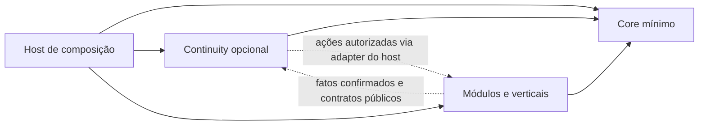

# Continuidade operacional — Agora, Passagens e Verificações

**Adendo documental 2.1.0 · 24/09/2026.** Decisão de produto adotada pelo pedido atual; desenho de contratos proposto, sem runtime implementado. `Wissian.Continuity` é nome técnico provisório; ID de catálogo `continuity`. A UX não precisa expor esses nomes. A [ADR-M08](adrs/ADR-M08_CONTINUIDADE_OPERACIONAL.md) registra a decisão; o [roadmap](09_ROADMAP_INTEGRADO.md) define a sequência e as [matrizes](matrizes/README.md) seus testes ainda NOT_RUN.

## 1. Resultado, origem e fronteira

Responder: **“O que precisa da minha atenção agora, por quê e qual é a ação correta?”** Preservar contexto entre pessoas, equipes, turnos e papéis, com decisão humana explícita quando o processo a exige. Não criar um gerenciador genérico de tarefas, uma mesa de comandos de desenvolvimento ou um dashboard de indicadores sem ação.

NexusDevHub e codex-checkpoint deixam de ser destinos de desenvolvimento independente nesta direção de produto. Seus repositórios são fontes temporárias para implementar as ideias deste plano. O encerramento autorizado, a preservação e a condição de descarte futuro pertencem ao [capítulo 05](05_GIT_E_REPOSITORIOS.md); arquivamento não comprova implementação. A origem dos conceitos é a decisão expressa de Gui e a conversa de análise; alegações anteriores sobre linhas de código, versões, CI ou cobertura não foram revalidadas e não são evidência deste pacote. Antes de aproveitar um algoritmo/caso específico, registrar commit, arquivo/símbolo, hash, licença, comportamento e teste de destino. Não é necessário transportar código para preservar um aprendizado.

| Aprendizado | Destino no Wissian | Implementação que não atravessa |
|---|---|---|
| Nexus: catálogo orientado a dados, cards e contexto | Metadados confiáveis de recursos e ActionCatalog, vinculados a módulos reais | Launcher, paths locais e configuração executável pelo cliente |
| Nexus: disponibilidade, frescor, resolução/ambiguidade e validações | ResourceHealth por referência, observação versionada, estado desconhecido explícito e health checks tipados | Busca heurística de BAT/EXE ou seleção silenciosa do primeiro resultado |
| Nexus: persistência, backup e recuperação | Transações, recibos, restore e reconciliação testados | Copiar JSON de desktop como banco SaaS |
| CC: stable keys, merge idempotente e fila determinística | Identidade estável de condição, ingestão deduplicada e ordenação previsível | Dependência do Codex ou de sessão local |
| CC: prioridade, instrução/resultado, flow/sequence, depends_on e bloqueios | WorkItem contextual, fluxo, grafo acíclico, motivo e responsável | Kanban genérico sem processo de origem |
| CC: feedback, notas, reabertura e decisão humana | Verificação vinculada a revisão/episódio, histórico e separação de responsabilidades | Automação aprovando em nome de uma pessoa |
| CC: concorrência, fail-closed e transação | Versionamento otimista, constraints, inbox/outbox quando necessários | Mutex, transaction journal ou armazenamento JSON do desktop |
| CC: importação defensiva e interfaces humana/máquina | Schema versionado, limites, validação e API determinística separada da experiência humana | `.ccard`, associação de arquivo Windows, ZIP do CC como formato do produto |

WPF/.NET Framework como aplicativo desktop, PowerShell/BAT/EXE arbitrários, launcher Windows e integrações específicas do Codex estão **aposentados como opções de implementação do SaaS**, não apagados da história. Isso não proíbe escolher .NET moderno por ADR nem ferramentas locais de engenharia autorizadas.

## 2. Encaixe sem duplicação

As setas tracejadas são interação em runtime, não importações circulares entre implementações. O host conecta portas públicas; Core e produtor funcionam sem Continuity. A capability pode consumir uma porta pública de origem sem receber suas tabelas ou DbContext. Uma integração habilitada declara versões/dependências reais; ausente, não inicia subscrição/job nem promete atendimento.

| Conceito já existente | Autoridade preservada | Papel adicional da Continuity |
|---|---|---|
| Identity, tenancy, authorization, catálogo e auditoria | Core/contratos vigentes | Reutilizar escopo e decisão de acesso; nunca outro serviço de identidade/permissões |
| Eventos | Owner do agregado confirma o fato | Consumir envelope comum; não tornar Events um broker obrigatório no Core |
| Notificações internas | Capacidade/adapter já adequado ao fluxo | Emitir apenas mudanças relevantes; falha de aviso não perde WorkItem; não duplicar motor/canais |
| Agenda, obrigação, ocorrência e prazo (WB-14) | Agenda/contratos | Projetar atenção por ocorrência, conservar recorrência na origem; conclusão de hoje não fecha amanhã |
| Conferência fiscal/financeira e revisão do mês | Fiscal, financeiro e monthly-close | Encaminhar e registrar a decisão humana pela mesma operação pública do owner |
| Estado de dispositivo/publicação/saúde | Devices/displays ou módulo produtor | Guardar referência e observação minimizada; não substituir inventário nem comando do dispositivo |
| Histórico de domínio e auditoria | Owners e serviço de auditoria vigente | ActivityHistory agrega referências autorizadas; WorkItemEvent registra a evolução própria |
| Continuidade de engenharia/C7 | Cofre interno e processo de desenvolvimento | Nenhuma dependência de produto; este capítulo é diferente do capítulo 12 |

Notifications e agenda continuam opcionais. A enumeração conceitual Identity/Tenancy/Authorization/Audit/Events/Notifications não muda a lista mínima do Core. Não criar `Resource` universal que absorva documentos, dinheiro e alojamentos.

## 3. Trio e fluxo do MVP M5-CO

**Primeiro consumidor proposto:** revisão de um pacote mensal sintético já implementado em M4, no módulo `monthly-close`. Usa conferência e reabertura existentes. Não aprova pagamento, validade fiscal ou contabilidade oficial. M5-CO.0 confirma o contrato e o papel revisor; se não houver resultado M4 utilizável, adiar M5-CO, sem inventar tarefas para alimentar a fila.

1. Operador prepara o pacote; origem persiste sua versão e emite `MonthlyClosePrepared`.
2. Uma pendência `monthly-close:{id}:review` aparece ao revisor autorizado, com motivo, instruções, resultado esperado e link para a versão. Repetir o evento não gera novo card.
3. Operador cria uma passagem contextual Operação → Revisão, agrupando referências resolvidas, que requerem atenção, bloqueadas ou que requerem confirmação. Revisor reconhece o recebimento quando essa política estiver habilitada.
4. Revisor abre a evidência e confirma, pede correção com motivo ou adia com prazo/motivo. O owner confirma a revisão efetiva antes de Continuity mostrar conclusão. Reconhecer passagem não aprova o pacote.
5. Correção gera nova versão na origem. A confirmação anterior fica preservada, porém não vale para a nova versão; reabre-se o episódio/verificação apropriado. O histórico permite entender quem decidiu, sobre qual versão e por quê.

### Agora

Somente itens do contexto autorizado, dirigidos ao usuário ou a um papel vigente e com ação pertinente agora. Mostrar título de negócio, motivo, origem, prioridade, prazo, instruções, resultado esperado, saúde/frescor e ação permitida. Nunca exibir IDs técnicos como linguagem principal.

Calcular elegibilidade antes de ordenar: permissão atual, módulo/integração ativos, revisão válida, dependências satisfeitas e adiamento vencido. Um bloqueado pode aparecer numa seção explícita de bloqueios se a pessoa puder remover o impedimento, sem botão falso de concluir. Sem permissão sobre a dependência, mostrar motivo genérico, sem título/ID/dados do recurso oculto.

Ordenação padrão determinística: prioridade decrescente → vencimento crescente (sem prazo ao final) → criação crescente → ID estável crescente. `flow_id`/`sequence` organizam a sequência dentro do fluxo, mas não substituem `depends_on`, autorização ou desempate total. Não usar IA, score opaco, ranking de pessoas ou reordenação aleatória. Repetir um alerta não renova artificialmente sua urgência nem `created_at`.

Adiado exige `deferred_until` e motivo; sai de Agora até o prazo, permanece localizável no contexto. Prioridade nova crítica só rompe adiamento por regra explícita do owner com evento/auditoria. “Tudo em dia” só quando leitura e frescor forem confiáveis; falha ou fila atrasada apresenta estado indisponível/desatualizado.

### Passagens

Handoff guarda origem/destino (pessoa, equipe, turno ou papel), escopo, período, autor, versão, política de reconhecimento, prazo quando aplicável e referências `(work_item_id, episode, version_at_handoff, category)`. Categorias: resolvido, requer atenção, bloqueado, requer confirmação. Não duplicar o WorkItem nem copiar corpos sensíveis para um resumo global.

Estados: rascunho → aguardando recebimento → recebida; cancelada/substituída preservam motivo e versão. MVP: um destinatário pessoa ou um papel escopado; quando papel, um membro elegível reconhece em nome desse papel, com autoria explícita. Múltiplos reconhecimentos obrigatórios ficam para fase posterior. Repetição do mesmo reconhecimento retorna recibo, sem novas passagens. Edição após envio gera nova revisão; reconhecimento antigo não cobre conteúdo adicionado.

Resumo mostra fotografia do que foi passado e estado atual autorizado, identificando mudanças. `received` prova recebimento explícito daquela revisão, não leitura de cada evidência, resolução de pendências ou aprovação crítica. Sem destinatário elegível, bloquear envio e encaminhar ao responsável operacional; não deixar item órfão ou escolher usuário de outro tenant.

### Verificações

Uma Verification referencia WorkItem/episódio e `source_entity_revision`, instruções, resultado esperado, evidências por referência, papel/pessoa competente e política de separação. Estados: aguardando, ajustes solicitados, adiada, confirmada e invalidada. Pedir ajustes reabre trabalho do originador com feedback; nova revisão invalida confirmação anterior para fins de liberação, preservando-a no histórico. Confirmação exige identidade humana autenticada, permissão específica e versão atual; serviço/IA/produtor não pode se passar pelo revisor.

Política crítica `requester_must_differ_from_approver` compara identidades humanas, não só nomes de papel. Acúmulo de papéis não satisfaz independência. Sem segunda pessoa autorizada, manter bloqueio com responsável e rota de escalonamento; não autoaprovar por SLA. Exceções de baixa criticidade devem pertencer ao domínio e ser explicitamente registradas, nunca derivadas de ser “Fultuma”.

O domínio guarda a condição de aprovação necessária e a revisão aprovada. Ausência, suspensão ou erro da Continuity não elimina esse gate. O fluxo nativo do módulo pode realizar a mesma decisão humana pelo mesmo contrato, sem duplicar autoridade. O solicitante vê “confirmação em processamento” até haver recibo do owner; timeout não vira confirmação.

## 4. Modelo de dados proposto, ajustado ao pacote

Usar a organização SaaS existente como tenant: `organization_id` no modelo canônico; `tenant_id` do envelope é o mesmo identificador validado. Não criar duas entidades/colunas com autoridades divergentes. `workspace_id` e `unit_id` são opcionais somente quando a arquitetura real os possuir; validar pertencimento à organização e a hierarquia entre ambos. O MVP pode ser escopado apenas à organização, sem inventar estrutura territorial.

| Agregado/relação | Campos e invariantes propostos |
|---|---|
| WorkItem | id, organization_id, workspace_id?, unit_id?, scope_key, stable_key, type, source_module, source_entity_id, source_entity_revision, source_sequence, episode, title, instructions, expected_outcome, priority, status, assigned_user_id ou assigned_role_id, flow_id?, sequence?, blocked_reason?, due_at?, deferred_until?, created_at, updated_at, version |
| WorkItemDependency | organization_id, scope_key, item_id/episode, prerequisite_id/episode; FKs escopadas, sem autoaresta/ciclo; mesmo escopo no MVP |
| WorkItemEvent | ID, escopo, item/episódio, versão, ator por referência, tipo, motivo controlado, instante, correlação e evento causador; append-only, sem corpo de documento |
| WorkItemComment | Escopo, item, autoria, texto limitado e revisão; acesso/retenção por classificação; edição não apaga autoria e registra correção |
| Handoff / HandoffItem / Acknowledgement | Fotografia versionada, referências/categorias, emissor/destinatário e reconhecimento explícito, idempotente e autorizado |
| Verification / Decision | Item/episódio, revisão de origem, política, decisão humana e recibo da origem; confirmação não migra para revisão diferente |
| ActionDefinition | Nome/versão, owner, handler registrado no servidor, schema de parâmetros/alvo, permissões exatas, efeito, política humana e idempotência |
| ActionExecution | Escopo, identidade solicitante, definição/versão, alvo/revisão, chave/fingerprint, estado, recibo, tentativas/correlação e resultado minimizado |
| ResourceHealth | Owner, referência de recurso, organização/escopo, source_sequence, observed_at, received_at, validade, estado e motivo; projeção, não cadastro universal |

Campos nulos não significam acesso global. `scope_key` é não nulo e calculado pelo servidor a partir do escopo autorizado (ex.: `organization`, `workspace:<id>`, `unit:<id>`); evita unicidade diferente por NULL. Não aceitar esse valor livre do navegador.

Unicidade proposta de WorkItem: **(organization_id, source_module, scope_key, stable_key)**. Chave derivada de condição/ocorrência estável; não conter nome, texto livre, PII, timestamp de entrega nem contador de retry. A chave identifica uma condição, não uma requisição. Nova origem/tipo/alvo incompatível sob a mesma chave é conflito, não merge. Um item por condição durante sua vida, com episódios versionados para recorrências; evento velho não reabre episódio encerrado. Rotinas recorrentes distintas incluem a ocorrência de domínio na chave.

Estados de WorkItem: pendente, em andamento, requer ajustes, adiado, concluído, cancelado. Prontidão/bloqueio é condição derivada, não um estado que esconda status e motivo. Transições exigem versão esperada: pendente/requer ajustes → em andamento/adiado; adiamento vencido → pendente; conclusão só por regra do owner/decisão humana exigida; cancelamento exige motivo/autoridade e não equivale a sucesso. Reabertura de concluído/cancelado exige fato novo autorizado e novo episódio, preservando eventos anteriores.

Uma dependência aponta também para o episódio do pré-requisito; somente conclusão válida o satisfaz. Cancelamento, adiamento, saúde desconhecida ou mera passagem recebida não liberam dependentes. Reabertura que invalide evidência de um sucessor em curso exige reconciliação explícita; não revogar/confirmar silenciosamente trabalho já feito. Rejeitar ciclos, arestas cruzadas e referências ausentes. Inserções concorrentes A→B/B→A precisam de proteção transacional comum ao grafo (lock escopado ou isolamento serializável com retry limitado); checagem isolada em memória é insuficiente.

Persistência relacional é direção, sujeita à ADR de stack. WorkItem/version/history/outbox correspondentes são gravados na mesma transação quando um efeito assíncrono existe. Atualizar por versão esperada; zero linhas afetadas produz conflito explícito, não last-write-wins. Append-only é para eventos/decisões, não promessa de reter PII eternamente: minimização, acesso e retenção seguem o capítulo 07. Não impor event sourcing completo, mutex ou journal de arquivo.

## 5. Eventos, merge e processamento confiável

Envelope proposto: `event_id`, `event_type`, `schema_version`, `producer`, `tenant_id`, `workspace_id?`, `unit_id?`, `source_entity_id`, `source_entity_revision`, `source_sequence`, `occurred_at`, `correlation_id`, `causation_id?`, `payload`. Todos os nomes/tipos suportados são registrados. Autenticar o produtor e validar seu escopo; conteúdo do evento nunca concede autorização. Auditoria e evento de domínio têm finalidades distintas; não reutilizar um evento de falha de auditoria como comando de negócio.

Entrega pode ser ao menos uma vez. Inbox com unicidade `(organization_id, producer, event_id)` e fingerprint do conteúdo detecta repetição: igual retorna resultado já registrado; ID repetido com conteúdo diferente é conflito/quarentena. A transação de consumo grava inbox, merge do WorkItem, histórico e eventual outbox; falha antes de commit permite repetição segura. Publicar fato de origem antes de commit ou marcar inbox processada antes da mudança causa perda e é proibido. Outbox do produtor nasce junto da mudança de domínio quando entrega durável for requerida.

Ordenar por sequência/revisão monotônica do agregado, nunca somente relógio do cliente. `occurred_at` informa experiência; não prova ordenação. Evento atrasado não regride saúde/estado; lacuna de sequência, revisão incompatível ou produtor sem ordem confiável exige reconciliar com o owner antes de alterar condição crítica. Reprocessar DLQ exige mesmo ID/chave e escopo revalidado, limite de tentativas e responsável; não gerar nova chave para forçar sucesso. IDs de dedupe têm retenção compatível com a janela de replay; expiração nunca permite reexecutar efeito não reconciliado.

Exemplo posterior M6: `DeviceOfflineDetected` → `stable_key=device:{id}:connectivity`. Eventos iguais atualizam a mesma condição; recuperação posterior muda ResourceHealth e pode concluir pela política ou criar verificação visual. Um offline antigo recebido após recuperação não reabre. Nova queda confirmada incrementa episódio. A confirmação da imagem anterior não confirma o novo episódio. Recurso ambíguo/sem escopo entra em atenção controlada, sem executar ação ou escolher primeiro candidato.

Merge altera somente campos que o produtor possui (observação/revisão e conteúdo de origem permitido). Preserva notas, adiamento, atribuição humana e decisões; mudança incompatível demanda conflito/reconciliação. Materializar a projeção novamente não envia notificações novamente nem executa comandos. Notificação tem chave própria `(tenant, destinatário, item, episódio, transição relevante, canal)`; repetição de telemetria não é nova transição.

## 6. ActionCatalog e fronteiras de segurança

Definições são empacotadas e revisadas no servidor. Navegador envia nome/versão de ação, alvo, parâmetros permitidos, versão esperada e chave idempotente. Não escolhe código, assembly, caminho, shell, handler, URL de callback ou credenciais. Registry resolve handler autorizado; schemas recusam campos desconhecidos, tamanhos excedentes e alvos incompatíveis. Navegação também revalida autorização no destino.

MVP permite somente as definições necessárias ao primeiro fluxo: `monthly_close.open` (consulta) e `monthly_close.request_review` (solicitação, sem aprovação). Verificação usa o comando público de decisão do owner, com regra humana, e não uma ação genérica “aprovar tudo”. Exemplos futuros preservados: `device.run_diagnostic`, `display.republish`, `schedule.open`, `notice.request_approval`, `inspection.start`, `report.generate`, `incident.acknowledge`. Cada um depende de contrato e handler concretos do módulo; esta lista não os implementa nem concede permissão.

Antes de aceitar e ao executar um job, combinar: contexto autenticado, associação atual, escopo/recurso/classificação, capacidade e módulo de origem habilitados, permissão exata, revisão/estado do objeto e política humana pertinente. A mesma validação precede retornar recibos de replay ou ler histórico. Revalidar revogação entre enqueue e execução. Nenhum papel curinga ou entitlement concede ação automaticamente.

Idempotência da execução: unicidade `(organization_id, action_name, idempotency_key)`, binding ao solicitante, alvo, revisão, versão do contrato e fingerprint normalizado dos parâmetros. Chave reutilizada com binding diferente → conflito sem efeito. Consulta ao recibo também exige autoridade atual. WorkItem stable_key, event_id e idempotency_key não são intercambiáveis.

Estados da execução: aceita, em execução, concluída, falhou, resultado desconhecido. Timeout após possível efeito entra em reconciliação; não repetir cegamente nem declarar sucesso. Handler também suporta dedupe/recibo; lease/fencing impede worker antigo de concluir execução retomada. Efeito externo sem suporte idempotente requer consulta/compensação definida, não promessa de exactly-once. Cancelamento antes de executar não prova reversão de efeito já enviado. Diagnóstico remoto, quando futuro, permite somente operações fixas do protocolo autenticado do dispositivo, jamais shell arbitrário.

API de máquina documenta schema, versões, erros, conflitos, paginação e limites. Interface humana apresenta ação/efeito e confirmação de risco no vocabulário do negócio. Integração pode solicitar verificação, nunca fabricar identidade/decisão humana. Importação futura terá prévia, schema e limites de tamanho/profundidade/lote/expansão, anti-replay e resultados por item; não aceitar uploads `.ccard` automaticamente. `ContinuityEnvelope` offline/export é apenas possibilidade futura, distinta do envelope de evento já especificado.

## 7. O que preparar e quando

| Etapa | Entregar quando autorizada | Não antecipar |
|---|---|---|
| M0 | Mapa de equivalências, ADR de stack, identidade organização/tenant, contratos mínimos e testes negativos; confirmar limites de reuso | Auditoria completa dos dois apps como bloqueio de toda fundação; cópia de código desktop |
| M1 | Escopo/autoridade/auditoria comuns; versões/conflitos; contrato mínimo de evento/idempotência exercitado por fixture transversal, sem importação Continuity | Tabelas WorkItem, UI Agora, motor de workflow, broker, canal de notificações, agendador universal |
| M2–M4 | Idempotência/transações/revisão nos próprios módulos; manter suas verificações nativas e metadados de correlação; definir evento útil quando houver consumidor | Tornar fechamento dependente da nova capability ou construir calendário paralelo |
| M5-CO.0 | Após M4: contrato monthly-close→Continuity, owner, política humana, escopo, dados/índices e orçamento de fila; caracterizar referências necessárias | Suporte genérico a todos os módulos |
| M5-CO.1 | WorkItem + ingestão transacional/outbox-inbox + Agora + verificação do pacote mensal; ActionCatalog mínimo | Regras editáveis/código do cliente, ações de dispositivo |
| M5-CO.2 | Passagens e reconhecimento, pedidos de ajustes/adiamento/reabertura integrados; trio completo testável | Otimização por IA ou múltiplas cadeias de aprovação |
| M5-CO.3 | Provas negativas, acessibilidade, ruído, restore e desativação/reativação; aceite humano do fluxo | Piloto real/produção implícitos |
| M5a/M6/M7 após demanda | Adapter de agenda/obrigações e ResourceHealth de dispositivo, ações tipadas específicas e operação autorizada | Monitor de parque, sincronização offline, importador CC e conectores externos por antecipação |

M5-CO é subtrilha independente de M5a/b/c, não renumera nem substitui nenhuma delas. M4 é prioridade e consumidor padrão escolhido; não significa dependência arquitetural do Core ou de todas as futuras verticais em financeiro. Se um consumidor comprovado justificar outra ordem, Gui pode repriorizar por ADR sem apagar M2–M4.

## 8. Aceite, sinais e recuperação

MVP concluído somente com trio no mesmo fluxo persistente e dois tenants sintéticos, sem código desktop/execução arbitrária; origem continua funcional sem capability. Repetir evento e comando, disputar versão, trocar escopo e revogar autoridade produzem os oráculos de TC-01…TC-22 em [testes planejados](matrizes/testes-planejados.json). Os JSON e verificadores deste pacote checam documentação, não demonstram esses comportamentos SaaS.

Medir atraso de projeção, itens ativos/adiados/órfãos, idade por prioridade, bloqueios sem responsável, retries/DLQ, conflitos, duplicatas suprimidas, passagens sem recebimento e verificações devolvidas/reabertas. Não usar contagem de notificações como sucesso nem IDs de pessoa/tenant como labels públicos. Métricas de valor: contexto recuperado, passagem reconhecida e decisão correta sobre revisão atual. Definir baseline, limiar e orçamento em M5-CO.0; nenhuma meta é evidência de desempenho antes da medição.

Desativação bloqueia novos comandos/subscrições da capability, preserva histórico e não remove gates da origem. Itens e decisões em trânsito ficam reconciliáveis; reativação exige replay limitado ou snapshot autorizado da origem, com IDs/ordem/dedupe preservados. Apresentar projeção incompleta como desatualizada até reconciliação terminar. Rollback: suspender a integração, retomar fluxo nativo com mesma autoridade, voltar código compatível e manter schema aditivo/histórico. Restaurar primeiro em destino sintético isolado; não apagar dados para “zerar fila”.

Próximo passo após esta preparação continua M0. Nome final de UX, volumes/SLO, retenção, canais, regras de escalonamento por cliente, contratos de dispositivos, offline e integrações externas ficam deliberadamente para seus slices. A decisão opcional e o trio não dependem de rediscutir a estratégia aprovada.

## 9. Reuso antes de construir

Reforço expresso de Gui: fragmentar, dividir e aprimorar o software existente, sem recriar do zero a plataforma administrativa ou seus addons. A especificação acima é um contrato-alvo para reconciliar com código e testes reais, não ordem de implementar um motor paralelo. M0/M5-CO.0 primeiro localizam equivalentes de fila, aprovação, auditoria, evento, idempotência, composição e UI nas bases existentes. Mapeamento por símbolo/ref/hash e testes decide manter/extrair/adaptar; apenas lacunas comprovadas justificam ligação/adaptação nova. Domínio específico fica no addon, por exemplo política de plantão socioeducativo ou diagnóstico de tela. A proibição de portar WPF/shell é preservada. WM-39/TC-21 verificam a trilha de reuso e impedem scaffold/rewrite por ausência de código nesta pasta.

## Natureza interna transversal — esclarecimento de produto

**Continuity é infraestrutura interna do Wissian a serviço de seus módulos**, com superfícies integradas de usuário (Agora, Passagens e Verificações). Não é ferramenta interna de desenvolvimento/Codex, produto independente, task manager paralelo ou addon comercial definido nesta decisão. “Opcional” significa que uma composição/produto usa a capacidade quando seus fluxos precisam; não significa obrigar o cliente a comprar ou configurar um sistema de tarefas à parte. Nenhum preço, SKU, assinatura separada ou contratação específica de Continuity foi decidido.

Core básico fornece mecanismos neutros mínimos. A camada transversal implementa mecanismos comuns de coordenação e contexto. Módulos administrativos e addons de especialidades conservam suas regras, evidências e autoridade; usam Continuity por contratos/eventos. Exemplo: regra de plantão e aprovação socioeducativa permanece na especialidade; deduplicação, encaminhamento e passagem versionada podem ser comuns. A interface pode aparecer dentro do próprio fluxo e em uma central compartilhada de atenção, sem exigir que a pessoa saiba o nome técnico Continuity.

A [conversa completa verificada](https://chatgpt.com/share/6ab56aa2-7a48-83e9-aa78-9d85f0317d41) confirma essa interpretação. O catálogo usa `kind=shared` para composição técnica, não para determinar comercialização. Autorização, ativação operacional e recursos disponíveis ainda são verificados; habilitar a integração não concede permissão nem elimina aprovação humana. M5-CO é trilha de integração ao produto, sem lançamento independente.

## 10. Demais usos preservados — além do trio inicial

A [matriz de reaproveitamento Nexus/CC](matrizes/reaproveitamento-nexus-cc.json) conserva 28 decisões de patrimônio e 18 formas de uso, com origem, motivo, destino, fase e ligação aos candidatos ABS-041…048. Não é outro backlog obrigatório nem catálogo comercial: distingue mecanismo comum, regra da especialidade, ideia futura e implementação aposentada. O trio é prioridade, não limite do patrimônio aproveitável. “Não implementar agora” jamais significa excluir essa possibilidade.

| Uso preservado da conversa | Responsabilidade e momento |
|---|---|
| Passagens entre plantões, operadores/supervisores, manutenção/operação, professor/coordenação, recepção/admin e turnos | Handoff comum; identidade dos papéis, protocolos, privacidade e critério de recebimento no módulo/vertical. Serve a socioeducativo, escolas, clubes, empresas, facilities e eventos quando houver demanda. `ShiftClosing` é exemplo futuro, não scheduler no Core. |
| Conferir dispositivo recuperado, horários importados, comunicado preparado e reparo concluído | Mesmo mecanismo Verification; evidência e regra pertencem respectivamente a devices/displays, agenda, comunicação e operação/manutenção. `ScheduleReadyForApproval` não publica por si só. Verificação visual de TV não equivale a teste de contenção física. |
| Recursos, contexto e atalhos dentro do fluxo | Documentos, dispositivos, rotinas e funções por referência; local, conteúdo e último estado disponíveis apenas a quem pode vê-los. Abrir recurso, reenviar conteúdo, abrir programação, diagnosticar e registrar problema usam ações tipadas. Sem cadastro universal concorrente. |
| Saúde operacional além da conectividade | Conservar os rótulos saudável, desatualizado, indisponível, não configurado, aguardando sincronização, degradado e requer verificação humana. Estado operacional, frescor e confirmação são dimensões distintas; uma observação saudável expirada não aparece como sucesso atual. Acrescentar desconhecido/ambíguo explícito quando não há evidência. |
| Stable keys para documentos vencendo, integrações, manutenção, alertas, rotinas, verificações, dispositivos, falhas de sincronização e regras automáticas | Uma condição/ocorrência por chave escopada; o módulo mantém calendário, validade e política. O contrato comum deduplica sem transformar telemetria em milhares de tarefas. |
| Pendências e bloqueios operacionais | Material pendente, peça em falta ou aprovação aguardada mantêm motivo, dono e rota de resolução. Resumo de passagem conserva resolvidos/atenção/bloqueados/confirmação. |
| Histórico e “Depois” | Histórico responde quem fez/decidiu/devolveu/confirmou e sobre qual revisão. Informação de relatório futuro sem ação atual fica fora de Agora; não vira tarefa ou alerta artificial. |
| Unidade de trabalho portável, inspirada no conceito `.ccard` | Preservar `ContinuityEnvelope` para offline, app móvel, filas, integrações, importação segura, migração, edge devices, recuperação e APIs. Adiar formato completo até consumidor real; o envelope de evento mínimo não precisa carregar toda a história. |

**Rules** significa, no MVP, regras pequenas registradas de mapeamento evento→condição/verificação/passagem, relevância, prioridade e roteamento; reaproveitar mecanismo compatível existente. Política de domínio permanece no owner. Não criar editor de regras, DSL, motor de workflow universal ou código configurável pelo navegador. Escalonamento/delegação/SLA devem resolver gargalos com autorização e prazo, sem autoaprovar, transferir privilégios ou contornar separação de pessoas.

**Portabilidade futura:** transportar contexto mínimo, referências, versão/episódio e história autorizada não transporta grant, identidade ativa ou aprovação válida para uma revisão diferente. Validar schema, tenant/escopo, procedência, limites, integridade e replay; prévia e merge conservam feedback e decisões. SHA-256 prova correspondência de bytes, não autenticidade/autoridade. Se assinatura for necessária ao caso, usar mecanismo de confiança definido pela stack e reautorizar no destino. Offline/móvel/edge requer reconciliação com o owner antes de efeito crítico. Importação, sincronização, fila de eventos e restore não exigem adotar `.ccard`, associação Windows ou ZIP legado.

As lições de testes também sobrevivem: propriedade do estado, fila, importação, concorrência/transação, interrupção de gravação, recuperação, smoke e render. Caracterizar os casos necessários antes de reaproveitar; CI/contagens relatadas na conversa não são execução atual nem aceite transferido. As bases existentes continuam primeira fonte de implementação; essas aplicações orientam fragmentar/adaptar, não construir tudo de novo.

WM-40/TC-22 exigem preservar esta cobertura em futuras fatias. A implementação do trio deve permitir os contratos necessários aos demais usos sem implementá-los antecipadamente; reavaliar por demanda, owner disponível, limites e custo real. A fase usa **M5-CO**, para não confundir com M5c (pessoas/serviços/privacidade) já existente.
